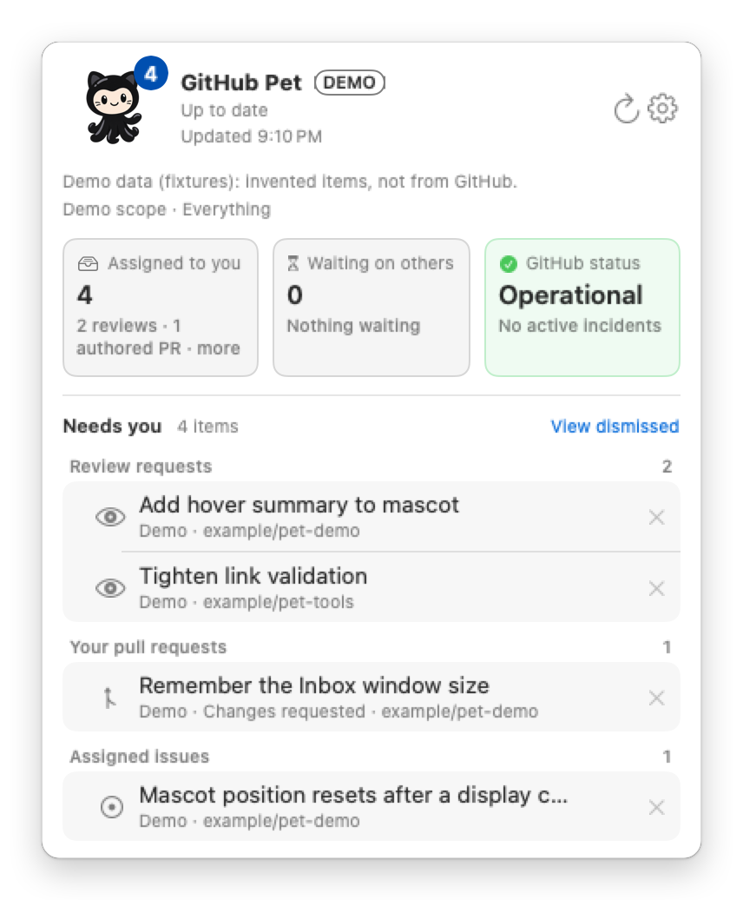
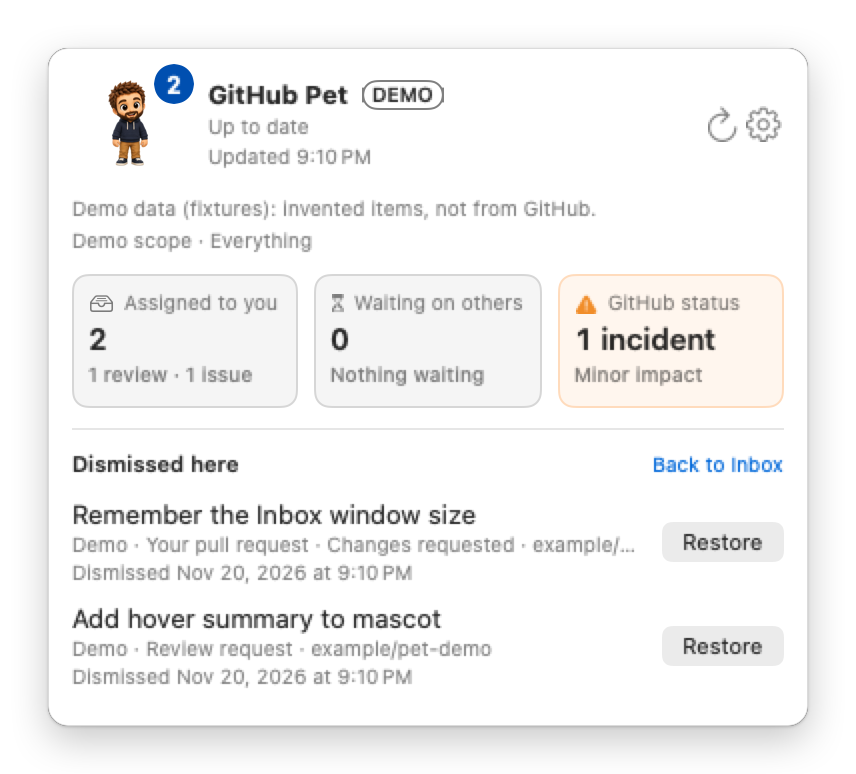
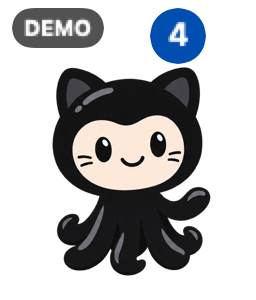
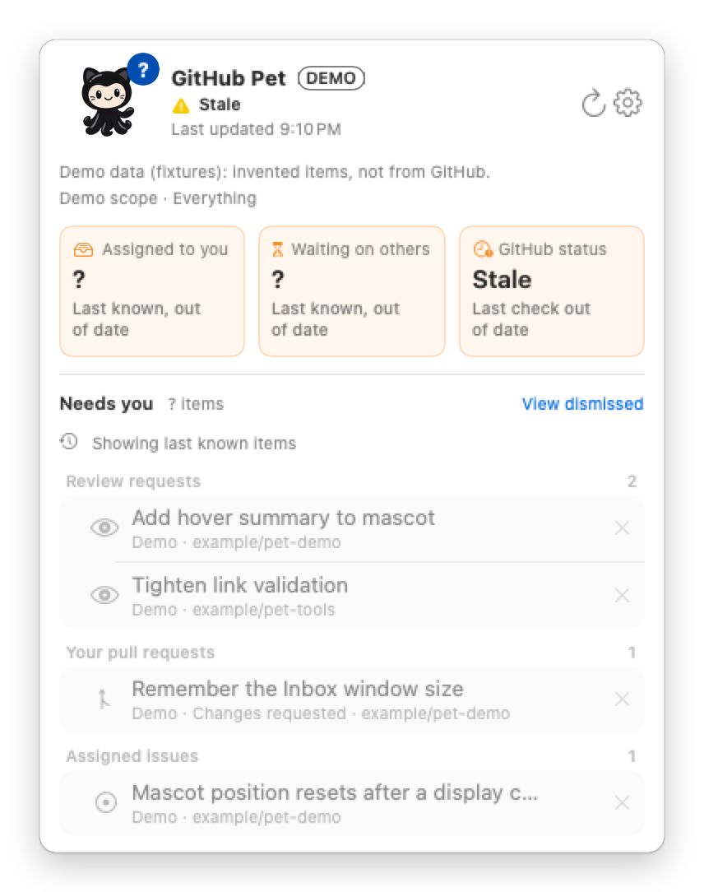
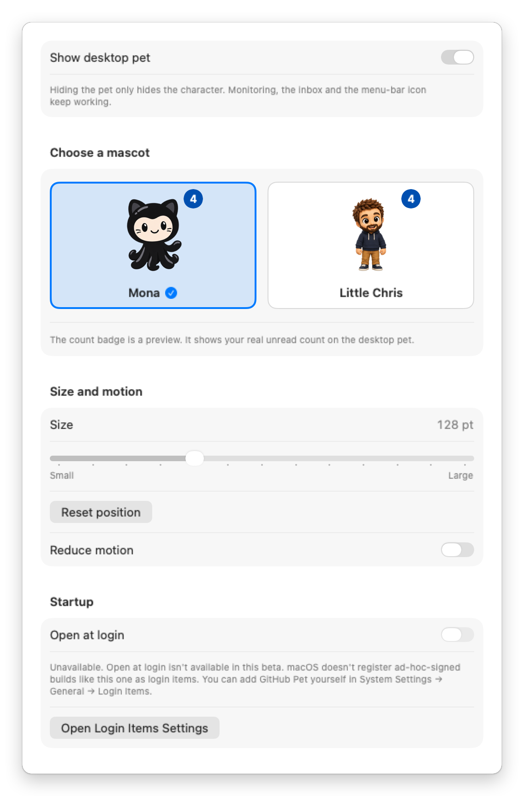
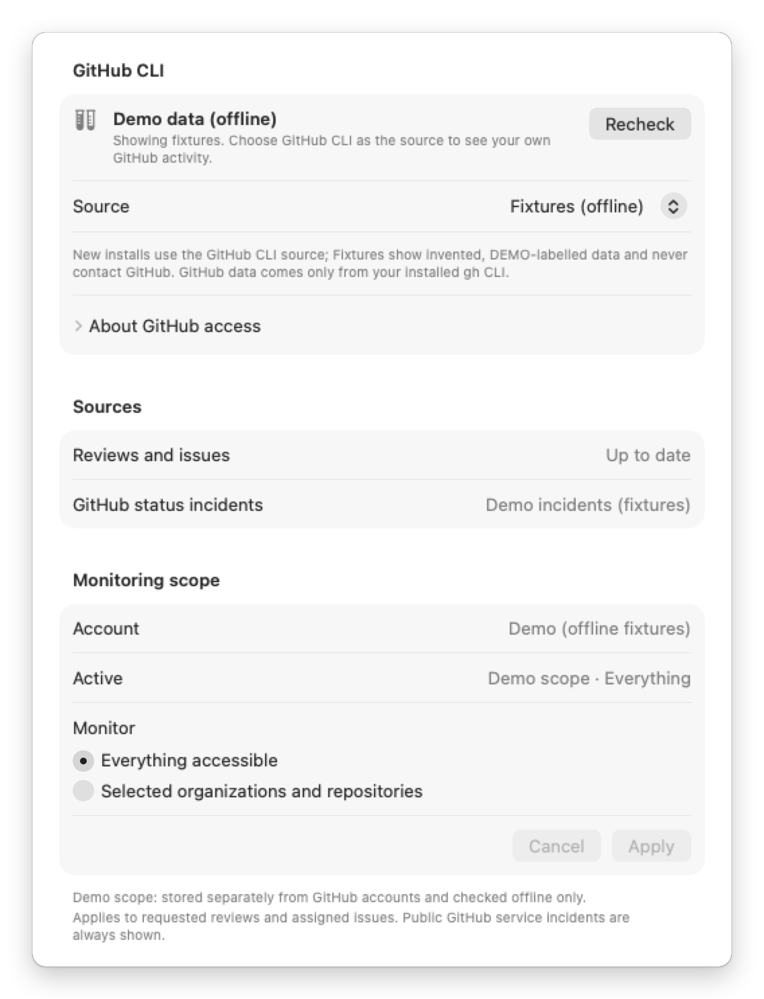

<div align="center">


# GitHub Pet

**A quiet macOS companion for the GitHub work that's waiting on you.**

Reviews, assigned issues and your pull requests in one calm Inbox, with a small pet on your desktop.
Read-only, local and built on the GitHub CLI you already use.

[**Download Beta 4**](https://github.com/christopherrbrown3/github-pet/releases) ·
macOS 13 or later · Universal app (Apple Silicon and Intel) · Free

<br>

<picture>
  <source media="(prefers-color-scheme: dark)" srcset="docs/screenshots/beta-4/hero-inbox-dark.png">
  
</picture>

</div>

> [!NOTE]
> **Beta.** GitHub Pet is a free, independent beta. Builds are ad-hoc signed and not notarized, so the
> first launch needs one approval in System Settings. See [Limits during the beta](#limits-during-the-beta).

## Get started

1. **Download** the newest `GitHubPet-…-universal.zip` from
   [Releases](https://github.com/christopherrbrown3/github-pet/releases), unzip it and move
   **GitHubPet.app** to Applications.
2. **Open it once, then choose Open Anyway** in System Settings → Privacy & Security. You do this one
   time; after that, updates arrive inside the app.
3. **Sign in to the GitHub CLI** with `gh auth login` ([install `gh`](https://cli.github.com) with
   `brew install gh`). GitHub Pet picks up your account. If `gh` is missing, the app tells you how to set
   it up instead of showing an empty Inbox.

The [installation guide](docs/install.md) covers checking the download, first launch in detail and
uninstalling.

A Homebrew cask is written and ready, but **not available yet**: it needs the project's tap, which hasn't been
created. Once it exists the command will be `brew install --cask christopherrbrown3/tap/github-pet`
([details](docs/install.md#homebrew-planned)). Until then, use the steps above.

## What it does

### One Inbox for what needs you

<picture>
  <source media="(prefers-color-scheme: dark)" srcset="docs/screenshots/beta-4/inbox-dismissed-dark.png">
  
</picture>

Review requests, issues assigned to you and your own pull requests that need a change sit in one list,
grouped by what they ask of you. Three tiles sum it up: **Assigned to you**, **Waiting on others** and
**GitHub status**.

Click a row and it opens on GitHub. Done with something? Dismiss it with **×**. It stays dismissed on this
Mac, and **View dismissed** lets you **Restore** it later.

<br clear="right">

### A pet that stays calm

<table>
  <tr>
    <td align="center" width="50%">
      <picture>
        <source media="(prefers-color-scheme: dark)" srcset="docs/screenshots/beta-4/mascot-mona-dark.png">
        
      </picture>
      <br><sub><b>Mona</b> (default)</sub>
    </td>
    <td align="center" width="50%">
      <picture>
        <source media="(prefers-color-scheme: dark)" srcset="docs/screenshots/beta-4/mascot-little-chris-dark.png">
        
      </picture>
      <br><sub><b>Little Chris</b></sub>
    </td>
  </tr>
</table>

An optional pet sits on your desktop with a badge counting the items that need you. It plays a short animation once for something
genuinely new, never on every refresh. Pick **Mona** or **Little Chris** in Settings, resize it, or hide
it: the Inbox and menu-bar icon keep working either way.

### Honest about what it knows

<picture>
  <source media="(prefers-color-scheme: dark)" srcset="docs/screenshots/beta-4/inbox-stale-dark.png">
  
</picture>

Loading, partial, out-of-date, signed-out and failed results are labelled for what they are. They never
pass for an empty Inbox, and the last good list stays visible with the time it was fetched.

Active GitHub incidents from githubstatus.com appear on their own, apart from your work.

<br clear="right">

### Simple settings

<table>
  <tr>
    <td align="center" valign="top" width="50%">
      <picture>
        <source media="(prefers-color-scheme: dark)" srcset="docs/screenshots/beta-4/settings-mascot-dark.png">
        
      </picture>
      <br><sub>Settings → <b>Mascot</b></sub>
    </td>
    <td align="center" valign="top" width="50%">
      <picture>
        <source media="(prefers-color-scheme: dark)" srcset="docs/screenshots/beta-4/settings-github-dark.png">
        
      </picture>
      <br><sub>Settings → <b>GitHub</b> (shown with Demo data)</sub>
    </td>
  </tr>
</table>

Settings has two panes. **Mascot** chooses and sizes your pet, turns motion down and opens Login Items
so you can add it yourself. **GitHub** shows your `gh` connection, what to watch (everything you can access,
or up to 10 organizations and repositories), entitlement-approval repositories, opt-in alerts for failing
Actions runs and deployment approvals, and updates.

More detail on every feature: [Features](docs/features.md).

## Private by design

- **No tokens.** GitHub Pet never asks for, reads or stores a token. All GitHub access goes through
  your own `gh` CLI and its sign-in.
- **Read-only.** It never approves, merges, comments or changes anything. Acting on an item opens it
  on github.com.
- **Local.** No backend, no account, no analytics. Settings and dismissals stay on your Mac. The
  network is used only by `gh` (github.com), the public githubstatus.com feed and update checks.
  Update checks fetch a static feed from GitHub (raw.githubusercontent.com), and updates download from
  GitHub Releases.

## Updates

Install Beta 4 by hand once. GitHub Pet then asks once whether to check for updates automatically. If
you agree, it checks in the background and asks before installing one; choose **Check for Updates…**
from the menu-bar menu any time. Each update is
verified with its signature before it's installed. [How updates work](docs/updates.md).

## Limits during the beta

- **Not notarized.** Builds are ad-hoc signed, so the first launch needs **Open Anyway**. Never turn
  off Gatekeeper; the guide never asks you to.
- **Open at login** can't be switched on by these builds. Settings has a button that opens Login Items,
  where you can add GitHub Pet yourself.
- **Simpler for now.** Privacy mode, snooze and quiet hours are hidden in this beta. Settings saved by an
  earlier beta are kept but have no effect until those features return.
- **github.com only.** GitHub Enterprise Server isn't supported yet.
- **Search limits.** At most 30 items per category; reaching that marks the result as partial.
- **Updates start after Beta 4.** In-app updates begin with the first release after Beta 4; earlier
  betas must install Beta 4 by hand.
- **Intel.** The universal app's Intel half is checked in CI under Rosetta, not on Intel hardware.
- **Not yet checked by hand:** keyboard and VoiceOver use of the new Inbox, and some behaviour on every
  supported macOS version.

Details and the rest of the known limits are in [Features](docs/features.md#known-limits).

## Build from source

```sh
gh repo clone christopherrbrown3/github-pet && cd github-pet
scripts/test.sh                 # tests
scripts/package-zip.sh          # universal, ad-hoc signed app + ZIP in .build/dist
```

See the [development guide](docs/development.md). README images are offscreen renders of Demo data;
see their [provenance](docs/screenshots/beta-4/README.md).

---

<sub>GitHub Pet is an independent project, not affiliated with or endorsed by GitHub. The mascots are
original artwork; see their [provenance](docs/design/provenance.md). All screenshots show invented Demo
data.</sub>
