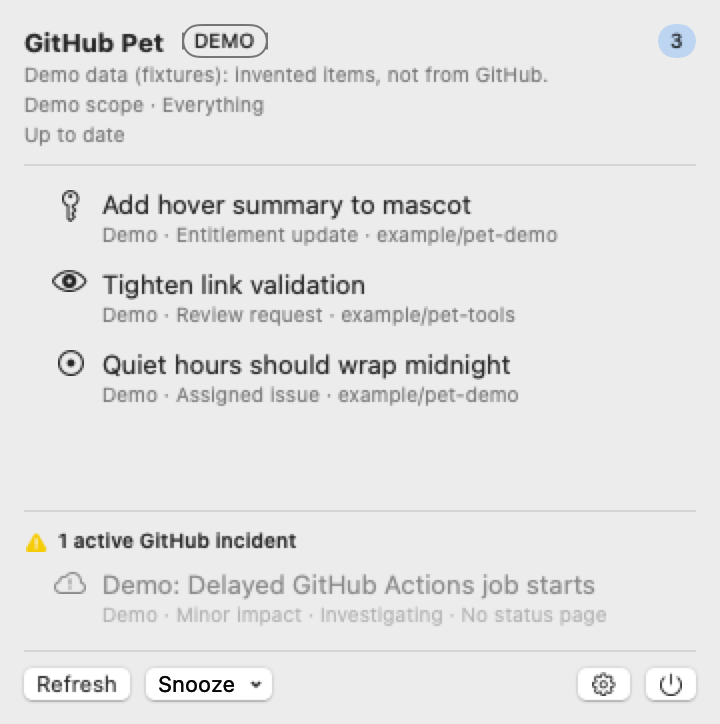
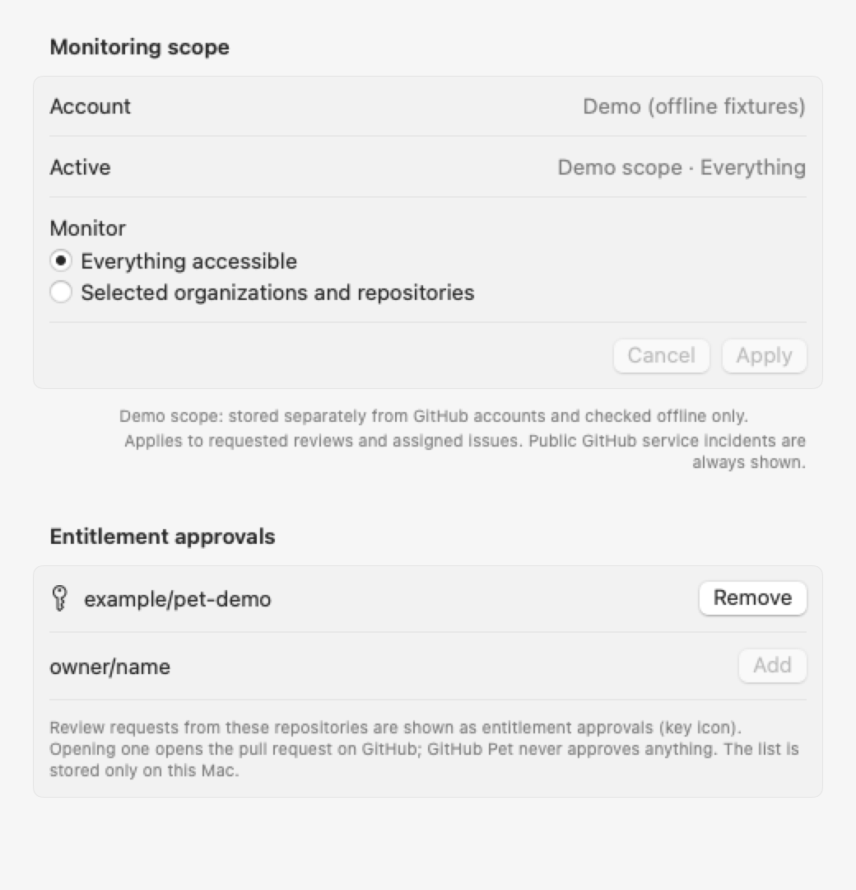
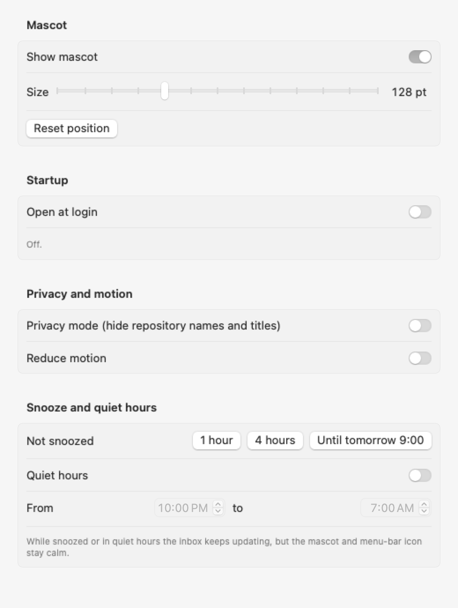

# GitHub Pet

A quiet macOS desktop companion that tells you when GitHub work is waiting for you, and opens it on GitHub when you choose to act.

<p>
  
</p>

> **Beta.** GitHub Pet is a free, independent beta. Builds are ad-hoc signed and not notarized, and some
> behaviour has not yet been checked on every macOS version; see [Limits](#limits-during-the-beta).
> Images on this page are offscreen renders of invented Demo data ([provenance](docs/screenshots/beta/README.md)).

## What it does

- **Review requests and assigned issues.** Pull requests waiting for your review and open issues assigned
  to you, from your GitHub CLI account on github.com. Click a row to open it on GitHub.
- **Choose what to watch.** Everything you can access, or up to 10 selected organizations and
  repositories. Access is checked before a selection is applied, and suggestions come from your account.
- **Entitlement approvals.** List the repositories where access requests arrive as pull requests; their
  review requests are marked with a key icon. GitHub Pet only opens the pull request; it never approves
  anything.
- **A companion that stays calm.** An optional animated mascot sits on your desktop with a count badge and
  a hover summary. It plays a short animation once for a genuinely new item, not on every refresh.
- **Remembers across restarts.** Items you have already seen don't come back as new after a relaunch;
  items that arrived while it was quit are announced once (within 24 hours).
- **Stays current.** With the GitHub CLI source it refreshes after your Mac wakes, and a Refresh clicked
  while a check is still running is remembered and runs once that check finishes.
- **Honest states.** Loading, partial, stale, signed-out, rate-limited, access-denied and failed results are
  labelled as such and never look like an empty inbox. Matches that GitHub counts but your account can't
  see are reported as a number.
- **GitHub service incidents.** Active incidents from the public githubstatus.com feed, kept separate
  from your own items.
- **Privacy, quiet hours and snooze.** Privacy mode (on by default) hides repository names and titles until
  you choose to show them. Quiet hours and snooze stop new-item animations and alerts; Reduce Motion
  keeps the mascot still. The inbox keeps updating either way.
- **Workflow failures (opt-in).** Failing GitHub Actions runs on the default branch of the repositories you
  select. Failures you triggered are urgent; others need attention. A row opens the run on GitHub.
- **Open at login.** An optional Settings toggle that shows what macOS reports: on, off or waiting for your
  approval.
- **Custom mascot packs (advanced).** Replace the artwork with your own pack by launching the app from
  Terminal with `GITHUB_PET_PACK_DIR` set to the pack's directory; there is no Settings control for it
  yet ([pack format](docs/design/README.md)). Every pack is validated; an invalid one falls back to the
  built-in placeholder without affecting monitoring.

| Idle | New item |
|:---:|:---:|
|  |  |

The red light beside the mascot marks an active GitHub service incident (a Demo incident here).

<p>
  
</p>

<p>
  
  
</p>

All images show invented Demo data (the app's offline fixtures), which is also what GitHub Pet shows
before you choose the GitHub CLI source. Dark-mode versions sit beside each image (`*-dark.png`).

## Requirements

- macOS 13 Ventura or later, Apple Silicon or Intel (universal app).
- For your own GitHub data: the [GitHub CLI](https://cli.github.com) (`brew install gh`), signed in with
  `gh auth login`. Without it, GitHub Pet runs on clearly labelled Demo data.

## Install

1. Download the **GitHubPet** ZIP and its `.sha256` checksum. Until GitHub Releases exist, they come from
   the **GitHubPet-app** artifact of the latest successful `main` build in GitHub Actions, which needs a
   GitHub account ([where to download](docs/install.md#1-download)). Check the checksum
   ([how](docs/install.md#2-check-the-download)).
2. Unzip it and move **GitHubPet.app** to Applications.
3. Open it once. Because the build is **ad-hoc signed and not notarized** (there is no paid Apple
   Developer account), macOS blocks the first launch. Approve it in **System Settings → Privacy &
   Security → Open Anyway**; you do this once per build. Don't disable Gatekeeper or remove quarantine
   attributes; the guide never asks you to.
4. GitHub Pet is a **menu-bar app** with no Dock icon. To see your own data, choose **GitHub CLI (gh)**
   under **Settings → Data source**.

The [installation guide](docs/install.md) also covers updating, uninstalling (including turning off Open
at login first) and keyboard access. A Homebrew cask is planned but not available yet.

## Privacy and safety

- **No tokens.** GitHub Pet never asks for, reads or stores a GitHub token. All GitHub access goes
  through your installed `gh` CLI and its own sign-in.
- **Read-only.** Nothing is approved, merged, commented on or changed from the app. Actions open the item
  in your browser, and only validated links are opened: github.com, and githubstatus.com for incidents.
- **Local.** No backend and no analytics. Settings, the entitlement repository list and the seen-items
  record stay on your Mac. Network use: only `gh` talking to github.com, and the public githubstatus.com
  API for incidents.
- **Fixed error messages.** Error text from `gh` or GitHub, which can name organizations, is classified
  rather than shown.

## Limits during the beta

- github.com only; GitHub Enterprise Server isn't supported.
- Each search returns at most 30 items per category; hitting that limit marks the result as partial.
- Open at login and the Gatekeeper approval step have not been verified on every supported macOS version.
- Refresh after wake is covered by automated tests only; it hasn't been checked on a real Mac sleeping
  and waking.
- Keyboard access goes through the menu-bar icon and Settings. The floating mascot isn't keyboard
  focusable, and a full live VoiceOver pass hasn't been done.
- Workflow failures are opt-in and cover only selected repositories (not organizations or Everything),
  and only their default branch's latest commit: a workflow that didn't run on that commit isn't seen.
  Deployment approvals and your own pull requests are not monitored yet.

After the beta: a Homebrew cask and GitHub Releases, then more sources. Progress is tracked in
[issues](https://github.com/christopherrbrown3/github-pet/issues).

## Build from source

```sh
gh repo clone christopherrbrown3/github-pet && cd github-pet
scripts/test.sh                 # tests
scripts/package-zip.sh          # universal, ad-hoc signed app + ZIP in .build/dist
```

See the [development guide](docs/development.md) for architecture and QA hooks. README images are
regenerated with [`scripts/readme-screenshots.sh`](scripts/readme-screenshots.sh).

---

GitHub Pet is an independent project and is not affiliated with or endorsed by GitHub. The mascot is
original Mona-inspired artwork; see its [provenance](docs/design/provenance.md).
