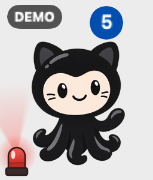
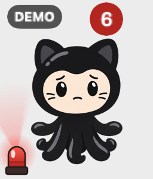
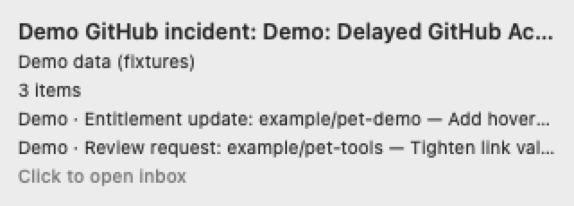
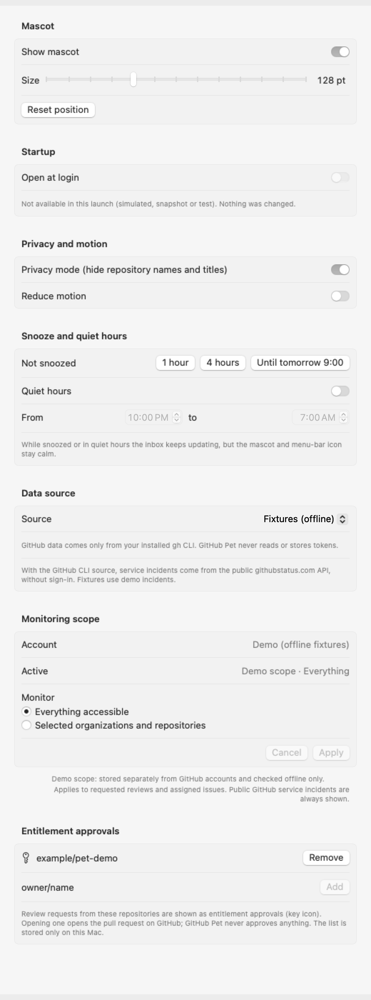

# GitHub Pet

A quiet macOS desktop companion that tells you when GitHub work is waiting for you, and opens it on GitHub when you choose to act.

<p>
  
</p>

> **Beta.** GitHub Pet is a free, independent beta. Builds are ad-hoc signed and not notarized, and some
> behaviour has not yet been checked on every macOS version; see [Limits](#limits-during-the-beta).
> Images on this page are offscreen renders of invented Demo data ([provenance](docs/screenshots/beta/README.md)).

## What it does

- **Review requests and assigned issues.** Pull requests waiting for your review and open issues assigned
  to you, from your GitHub CLI account on github.com. Click a row to open it on GitHub.
- **Choose what to watch.** Everything you can access, or up to 10 selected organizations and
  repositories. Access is checked before a selection is applied, and suggestions come from your account.
- **Entitlement approvals.** List the repositories where access requests arrive as pull requests; their
  review requests are marked with a key icon. GitHub Pet only opens the pull request; it never approves
  anything.
- **A companion that stays calm.** An optional animated mascot sits on your desktop with a count badge and
  a hover summary. It plays a short animation once for a genuinely new item, not on every refresh.
- **Remembers across restarts.** Items you have already seen don't come back as new after a relaunch.
- **Stays current.** It refreshes after your Mac wakes, and a Refresh clicked while a check is still
  running is remembered and runs once that check finishes.
- **Honest states.** Loading, partial, stale, signed-out, rate-limited, access-denied and failed results are
  labelled as such and never look like an empty inbox. Matches that GitHub counts but your account can't
  see are reported as a number.
- **GitHub service incidents.** Confirmed incidents from the public githubstatus.com feed, kept separate
  from your own items.
- **Privacy, quiet hours and snooze.** Privacy mode (on by default) hides repository names and titles until
  you choose to show them. Quiet hours, snooze and Reduce Motion keep the mascot still while the inbox
  keeps updating.
- **Open at login.** An optional Settings toggle that shows what macOS reports: on, off or waiting for your
  approval.
- **Custom mascot packs.** Replace the artwork with your own validated pack; an invalid pack falls back to
  the built-in placeholder without affecting monitoring.

| Idle | New item | Urgent |
|:---:|:---:|:---:|
|  |  |  |

<p>
  
  
</p>

Dark-mode versions sit beside each image (`*-dark.png`).

## Requirements

- macOS 13 Ventura or later, Apple Silicon or Intel (universal app).
- For your own GitHub data: the [GitHub CLI](https://cli.github.com) (`brew install gh`), signed in with
  `gh auth login`. Without it, GitHub Pet runs on clearly labelled Demo data.

## Install

1. Download the **GitHubPet** ZIP and its `.sha256` checksum, and check it
   ([installation guide](docs/install.md#2-check-the-download)).
2. Unzip it and move **GitHubPet.app** to Applications.
3. Open it once. Because the build is **ad-hoc signed and not notarized** (there is no paid Apple
   Developer account), macOS blocks the first launch. Approve it in **System Settings → Privacy &
   Security → Open Anyway**; you do this once per build. Don't disable Gatekeeper or remove quarantine
   attributes; the guide never asks you to.
4. GitHub Pet is a **menu-bar app** with no Dock icon. To see your own data, choose **GitHub CLI (gh)**
   under **Settings → Data source**.

The [installation guide](docs/install.md) also covers updating, uninstalling (including turning off Open
at login first) and keyboard access. A Homebrew cask is planned but not available yet.

## Privacy and safety

- **No tokens.** GitHub Pet never asks for, reads or stores a GitHub token. All GitHub access goes
  through your installed `gh` CLI and its own sign-in.
- **Read-only.** Nothing is approved, merged, commented on or changed from the app. Actions open the item
  on github.com in your browser, and only validated github.com links are opened.
- **Local.** No backend and no analytics. Settings, the entitlement repository list and the seen-items
  record stay on your Mac.
- **Fixed error messages.** Error text from `gh` or GitHub, which can name organizations, is classified
  rather than shown.

## Limits during the beta

- github.com only; GitHub Enterprise Server isn't supported.
- Each search returns at most 30 items per category; hitting that limit marks the result as partial.
- Open at login and the Gatekeeper approval step have not been verified on every supported macOS version.
- Keyboard access goes through the menu-bar icon and Settings. The floating mascot isn't keyboard
  focusable, and a full live VoiceOver pass hasn't been done.
- Workflow failures, deployment approvals and your own pull requests are not monitored yet.

After the beta: a Homebrew cask and GitHub Releases, then more sources. Progress is tracked in
[issues](https://github.com/christopherrbrown3/github-pet/issues).

## Build from source

```sh
gh repo clone christopherrbrown3/github-pet && cd github-pet
scripts/test.sh                 # tests
scripts/package-zip.sh          # universal, ad-hoc signed app + ZIP in .build/dist
```

See the [development guide](docs/development.md) for architecture and QA hooks. README images are
regenerated with [`scripts/readme-screenshots.sh`](scripts/readme-screenshots.sh).

---

GitHub Pet is an independent project and is not affiliated with or endorsed by GitHub. The mascot is
original Mona-inspired artwork; see its [provenance](docs/design/provenance.md).
