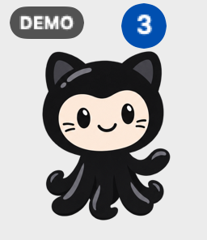
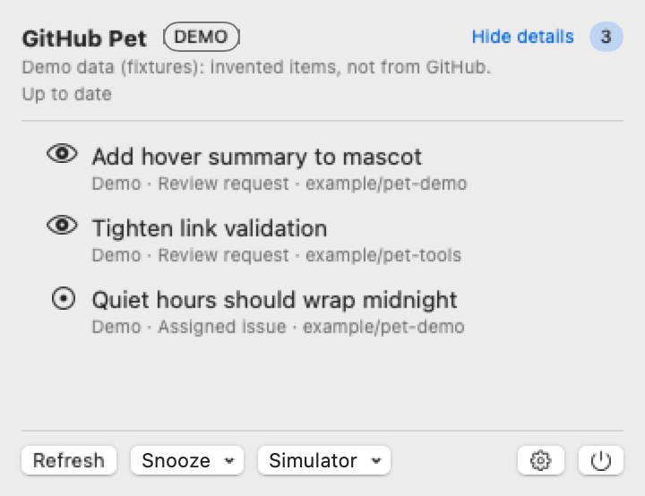
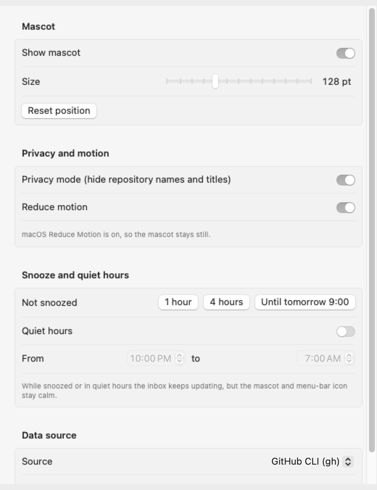

# GitHub Pet

A small desktop companion that helps you notice the GitHub work waiting for you.

GitHub Pet is a native macOS app built with SwiftUI and AppKit. An optional animated Mona-inspired character lives on your desktop, with a persistent menu-bar inbox for actionable alerts. The goal is to tell you when something needs your attention, give you a brief preview, and open the relevant GitHub page when you choose to act.

No hosted backend. All authenticated GitHub access goes through your locally installed **GitHub CLI (`gh`)**. The app does not own or store GitHub tokens. It opens validated GitHub item links in your browser and performs no approval mutations.

> **In development:** the application prototype is in [PR #18](https://github.com/christopherrbrown3/github-pet/pull/18). The default branch currently contains project setup, artwork, and design specifications. There is no packaged release or working Homebrew install command yet.

## A look at the prototype

These images are native SwiftUI/AppKit **offscreen renders** from the prototype at [`50ad2fe`](https://github.com/christopherrbrown3/github-pet/commit/50ad2fe74da7809a4b5f7e91a1b819984270d58e), generated by its render-check workflow. They show separate test scenarios, not a live desktop session. Inbox items are invented fixtures, explicitly marked **DEMO**. [Image provenance](docs/screenshots/prototype-50ad2fe/README.md).

### Desktop companion and shared inbox

<p>
  
</p>

Click the companion to open the same inbox available from the menu bar. The character can be hidden while monitoring continues.



### Settings

The prototype includes mascot size and visibility, privacy, reduced motion, snooze, quiet hours, and fixture/live-source selection. This render shows a different settings scenario with the GitHub CLI source selected.



The images show the implementation snapshot at `50ad2fe`, not complete acceptance: live resizing, desktop placement, animation, and accessibility checks are still being worked through. Later changes may differ from this pinned snapshot.

## What works today

The open prototype PR includes:

- A menu-bar inbox and a transparent, draggable companion window with hover preview and click-to-open Inbox.
- Responsive count badges, original mascot artwork, idle and event animation infrastructure, and replaceable mascot-pack metadata.
- Fixture simulation for new events and incomplete, stale, disconnected, and authentication states.
- Privacy controls, reduced motion, quiet hours, and snoozing.
- An initial read-only live mode for **PR reviews requested from you** and **open issues assigned to you**, using the active `gh` account on github.com.

Fixtures are the default. Live mode currently searches relevant activity across accessible repositories without a repository filter. Each search is capped at 30 results; hitting the cap marks the snapshot as partial. The stronger new-notification animation implementation is in unmerged [PR #18](https://github.com/christopherrbrown3/github-pet/pull/18) and is pending verification ([#29](https://github.com/christopherrbrown3/github-pet/issues/29)).

Unknown, failed, partial, or stale data must stay distinguishable from a verified empty inbox. An initial sync establishes a baseline; unchanged polls and noncomparable recovery must not manufacture new notifications.

## Where the project is headed

The finished app should be a quiet, local inbox for the GitHub events you can act on:

| Planned source | Intended signal |
|---|---|
| Entitlements/access workflows | PR-based access requests awaiting your eligible review |
| Pull requests | Review requests and authored PRs requiring attention |
| Issues | Open issues assigned to you |
| GitHub Actions | Workflow failures in the monitored scope |
| Deployments | Deployment approvals awaiting action |
| GitHub Status | Confirmed service incidents, distinguished from failed status checks |

Review requests and assigned issues have initial live implementations; the other integrations remain planned or incomplete. GitHub outage checking is **not connected yet** ([#11](https://github.com/christopherrbrown3/github-pet/issues/11)).

You will be able to choose **individual repositories, organizations, or everything** accessible to your account ([#30](https://github.com/christopherrbrown3/github-pet/issues/30)). Entitlements repository names will be local configuration, with no internal organization details built into this public project.

The companion should make a new actionable event noticeable with a finite animation, while respecting reduced motion, privacy, quiet hours, and snooze. An inbox item stays available after the animation ends. Mascot packs should make the artwork and animation replaceable without rewriting monitoring logic.

## Install a development build

There is no tagged release or Homebrew cask yet. Every build of `main` produces a universal
(Apple Silicon + Intel) **GitHubPet.app ZIP with a SHA-256 checksum** as the GitHub Actions
artifact **GitHubPet-app**. **[Installation guide](docs/install.md)** covers downloading it,
checking the checksum, moving the app to Applications and approving its first launch.

GitHub Pet doesn't use a paid Apple Developer account. Its builds are **ad-hoc signed and not
notarized**, so macOS asks you to approve the app once: **System Settings → Privacy & Security →
Open Anyway**. On macOS 15 and later this replaces the old Control-click → Open shortcut. The guide
never asks you to remove quarantine attributes or turn off Gatekeeper.
[Apple's first-launch guidance](https://support.apple.com/en-us/102445).

It is a **menu-bar app with no Dock icon**, and it starts on invented **Demo** data. For your own
review requests and assigned issues, install the GitHub CLI, sign in with `gh auth login`, and choose
**GitHub CLI (gh)** in Settings. GitHub Pet uses that CLI's sign-in; it never asks you to paste a
token into the app.

To build it yourself (Xcode or just the Command Line Tools):

```sh
gh repo clone christopherrbrown3/github-pet && cd github-pet
scripts/package-zip.sh
open .build/app/GitHubPet.app
```

See the [development guide](docs/development.md) for tests and QA hooks.

## Distribution plan

Next is a **Homebrew cask in a project-owned tap**, and then GitHub Releases with the same ZIP.
Updates will use Homebrew or a new download. Installation work is tracked in
[#15](https://github.com/christopherrbrown3/github-pet/issues/15).

## Follow development

- [Product requirements](docs/PRODUCT.md)
- [Issues and backlog](https://github.com/christopherrbrown3/github-pet/issues)
- [Development board](https://github.com/users/christopherrbrown3/projects/3/views/1) — currently private; owner access required
- [Mascot and interface design](docs/design/README.md)
- [Team operating guide](docs/team/OPERATING.md)

GitHub Pet is an independent project and is not affiliated with or endorsed by GitHub. The Mona-inspired artwork is original generated artwork; its provenance is documented in [the design handoff](docs/design/provenance.md).
