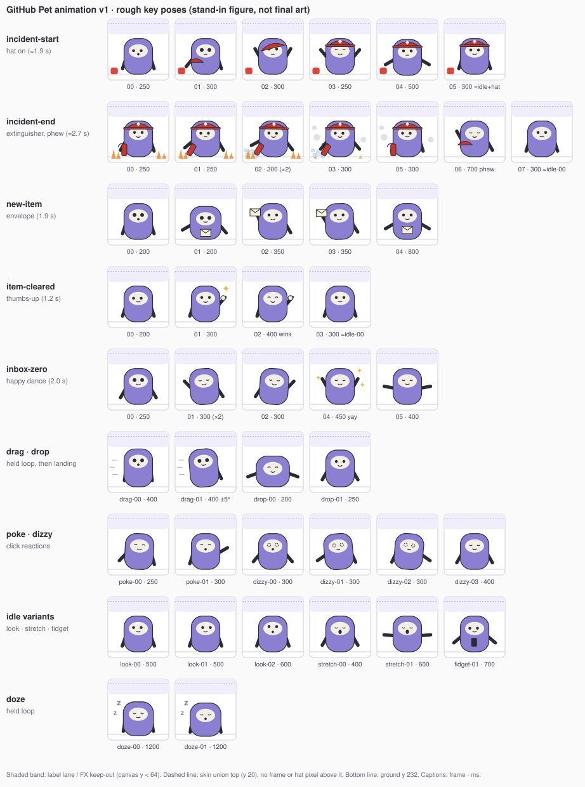

# Animation v1: firefighter, idle variety, item and interaction reactions (#138)

Plan step 1 of [#138](https://github.com/christopherrbrown3/github-pet/issues/138): prune the brainstorm into a v1 set, storyboard every animation, propose the pack-format change and hand Codex an asset list. Developer builds the engine (plan step 2) in parallel against the names, triggers and priorities below, using placeholder frames.

Aim: fun but not intrusive. Big motion only for real events. Ambient extras are rare and small. Nothing loops for attention once seen. No sound. Reduce Motion shows static poses only.



The thumbnails use a neutral stand-in figure, not either skin. They show poses, props, timing and the layout limits. Rebuild them with `python3 -B docs/design/animation-v1/draw_storyboards.py`.

## 1. The v1 set

| Name (manifest key) | Kind | Trigger in one line | Frames (new + reused) | Length |
|---|---|---|---|---|
| `incident-start` | event clip | An incident event makes the incident marker appear | 5 + 1 composite | 1900 ms |
| firefighter hat (`firefighter-hat`) | accessory overlay | Shown whenever the incident marker is shown | 1 overlay | held |
| `incident-end` | event clip | All incidents resolve on a fresh status fetch while the marker was shown | 6 + 2 reused | 2700 ms |
| `new-item` | event clip | A batch of new actionable items (replaces the double wave when the pack has it) | 5 | 1900 ms |
| `urgent` (existing) | event clip | A new critical inbox item, unchanged. Never played for an incident. | existing | 2000 ms |
| `item-cleared` | outcome clip | You dismiss a Needs you row in the Inbox | 3 + 1 reused | 1200 ms |
| `inbox-zero` | outcome clip | A fresh poll verifies an empty inbox after it had items | 5 + 1 reused | 2000 ms |
| `drag` | held state (loop) | Pointer drag past the 3 pt threshold | 2 | 800 ms loop |
| `drop` | reaction clip | Mouse up after a drag | 2 | 450 ms |
| `poke` | reaction clip | Pointer click on the mascot | 2 + 1 reused | 750 ms |
| `dizzy` | reaction clip | Fifth click within 3 s | 4 + 1 reused | 1600 ms |
| `idle-look` | ambient clip | Random, rare | 3 + 1 reused | 2000 ms |
| `idle-stretch` | ambient clip | Random, rare | 4 + 1 reused | 2400 ms |
| `idle-fidget` | ambient clip | Random, rare (Mona: tentacle curl; Little Chris: checks phone) | 3 + 1 reused | 1800 ms |
| `doze` | held state (loop) | 15 min of calm with no interaction | 2 | 2400 ms loop |

The existing `idle` (blink loop), `attention` and `urgent` states keep their v1 meaning and frames.

Every new clip and state is optional in a pack. A pack without one mostly behaves as today: `new-item` falls back to the #29 double wave, and reactions or ambient clips do not play. **Incidents change on purpose, even for a pack without `incident-start`** (custom packs, and the bundled packs until the art lands). An incident start with the marker previously off plays the attention double wave, whatever its severity. A second incident or an escalation plays no character clip. An incident never plays `urgent`, which today it does for major and critical impact. The placeholder figure has none of the new clips.

### Cut, and why

| Brainstorm idea | Decision | Reason |
|---|---|---|
| Smoother flames, layered smoke, rotating siren | Deferred | The procedural marker (#37) already ships with a beacon sweep. Polishing it is separate engine work. v1 adds only an extinguish phase for `incident-end`. |
| Hard hat and cone for minor, full gear for major | Cut | The marker already shows the tier. Two outfits would double the accessory art per skin and make every clip hat-dependent. One hat for every tier. |
| Sip of coffee, time-of-day touches (sleepy at night, morning coffee) | Cut | Needs a prop and clock logic for little gain. Doze covers the sleepy look, and quiet hours lets the mascot doze straight away. |
| Separate tail or tentacle wiggle | Merged | Becomes Mona's `idle-fidget`. |
| Little Chris adjusts his hoodie | Cut | One fidget per skin. Checking a phone reads better at 64 pt. |
| Juggling or a paper stack for several items | Cut | #29 plays one gesture per batch, and the badge already shows the count. |
| Tapping a watch for authored items | Cut | Reads as nagging. Authored items use `new-item`. |
| Facepalm or wrench for CI failure | Cut | A facepalm can read as judging the user. The calm `urgent` clip already covers critical items. A wrench could come in v2. |
| Broom sweep, filing motion, confetti | Merged | Becomes `item-cleared`: a thumbs-up and a single sparkle. Confetti is too busy at 64 pt. |
| "Wheee" on fast drags | Cut | It would need text or sound. The drag lean conveys speed. |
| Wave on hover | Cut | Hover already shows the summary. Motion on every hover is intrusive. |
| Double-click spin | Cut | A click already opens the Inbox, so a double-click toggles it twice. A full spin also breaks the art bounds rule (section 4). |
| Peeking back after being thrown off-screen | Cut | Needs window physics and off-screen positions, which conflict with saved-position handling. |
| Wake-up clip after doze | Cut | Whatever woke the mascot plays its own clip at once, which reads as waking. |

## 2. Rules that apply to every clip

### Priority and interruption

Higher tiers preempt lower ones at once. The new clip starts at frame 0 with no blend, and the preempted clip is discarded, never resumed.

| Tier | Members (high to low within the tier) | Same-or-lower arrival while playing |
|---|---|---|
| 0 | `drag` (held state) | — |
| 1, event | ordered by severity, then kind rank, then earlier start (below) | Existing `EventClipQueue` rules (#29): merge, no restart, no queue, no backlog. |
| 2, outcome | `inbox-zero` > `item-cleared` | Dropped |
| 3, reaction | `drop` > `dizzy` > `poke` | Dropped (`dizzy` replaces `poke` when it triggers) |
| 4, ambient | `idle-look`, `idle-stretch`, `idle-fidget` | Dropped |
| 5 | `doze` (held state) | — |
| base | mood: `idle` loop, or the `attention` / `urgent` static pose | — |

**Tier 1 order is deterministic.** `EventClipQueue.Clip` gains a clip-kind field. The visible clip is chosen by:

1. severity, higher first (critical > actionable);
2. kind rank, high to low: `urgent` (critical inbox event) > `incident-start` > `incident-end` > `new-item` (and the old wave);
3. the earlier `startedAt`.

Incident clips carry their incident's severity: a major or critical incident start is critical, so it outranks `new-item`. If a critical inbox event and an incident start collide, both are critical and `urgent` wins by kind rank. The hat overlay still appears, because the marker is shown.

Drag is special. While a drag is held the `drag` pose masks everything. Tier 1 clips that start or are already running keep their own clock, so nothing is replayed after the drop. Tier 2 to 4 clips are discarded. On mouse up, a tier 1 clip still inside its window shows its remaining frames and `drop` is skipped. Otherwise `drop` plays.

### Gating

| Gate | Tier 1 event clips, `inbox-zero` | `item-cleared`, `drag`, `drop`, `poke`, `dizzy` | Ambient clips | `doze` | Hat overlay |
|---|---|---|---|---|---|
| Reduce Motion (system or app setting) | not played | not played; `drag` shows its static fallback while held | not played | static fallback, no Z | shown (static) |
| Quiet hours, snooze (only if those hidden features return; `FeatureSet.current` has them off today) | not played (as today) | played: the user caused them | not played | allowed, and enters at once | shown |
| Mascot hidden | nothing plays | — | — | — | — |
| Stale, error, loading data | unchanged existing treatment | played | played | not entered | follows the marker (hidden) |

Reduce Motion means no clip ever plays. The only visual changes are pose substitutions: the hat while the marker shows, the doze pose and the drag pose. A Reduce Motion switch while a clip plays stops it at once, as `cancelGesture` does today.

### Never misrepresent state

- The hat is shown exactly when `IncidentMarker.current(...)` is non-nil. Stale, failed or loading status hides the marker, so the hat goes too. No clip plays for that.
- `incident-end` only celebrates a verified resolution (section 3.3).
- `inbox-zero` only plays for a verified fresh empty inbox (`DataState.empty`), never for "all current items dismissed" (`hiddenOnly` or local dismissals), partial or unknown data.
- `doze` requires fresh data and no incident marker. A sleeping mascot must never stand in for "nothing is happening" when the app does not know.
- Animation never changes the badge, hover text or accessibility label.

### Timing and resources

- One clock: every clip, lean and FX position is a pure function of (clip start, now), read from the existing `TimelineView`. There are no per-clip timers. The rates are 30 fps while a clip, lean, FX or drag runs, and 8 fps otherwise (idle loop, doze).
- Frame durations use the v1 range of 125 to 2000 ms.
- Ambient scheduling uses a seeded random generator (seeded once per launch, injectable for QA), so the QA clock and scenario runner can reproduce it.
- After a clip ends the mascot returns to the current mood's pose: the `idle` loop restarts from frame 0, or `attention` / `urgent` holds its static pose.

## 3. Storyboards

Coordinates are in the 256 × 256 canvas, y down, ground anchor `[128, 232]`. Frame names are pack-relative (`frames/<name>-NN.png`). "Reused" frames are paths already in the pack.

Two layout facts drive every storyboard:

- **The count badge** sits in the lane above the art, at the top right, and slides down to stay near-touching each drawn pose's top contour (#28). **Hover** sits beside the union of all poses (#27, #116).
- **The bounds rule (bundled packs):** every new frame, and every frame with the hat composited, keeps all pixels with alpha > 0 inside the skin's current union. That is x 47–217, y ≥ 20 for Mona and x 62–205, y ≥ 20 for Little Chris, measured at alpha > 8 from today's frames. Lane height and hover placement then never change, and the badge keeps tracking per frame. Props go on the left (the side away from the count slot) when they would otherwise rise toward the top.

FX sprites (mist, sparkle, Z, smoke puff) are drawn by the engine in world space behind or in front of the art. They are clipped exactly like the incident marker: never above canvas y 64, never within 2 pt of DEMO or the reserved `99+` slot. They are excluded from contours.

### 3.1 Firefighter hat (accessory)

- **Shown:** whenever `IncidentMarker.current` is non-nil, on every pose (idle loop, attention/urgent static poses, any clip whose `accessories` is `keep`). Not shown inside `incident-start` or `incident-end`, which bake the hat into their frames.
- **No clip on its own.** Launching mid-incident, reconnecting, or recovering from stale status shows the hat directly (baseline, no event). This matches the marker's own no-replay rule.
- **Placement:** the overlay is authored on the canvas for the `idle-00` head. For other frames it is translated by `framePoints[frame].head − points.head` (section 4). It is drawn above the art and below labels, and it rotates with the art lean.
- **Ambient clips and doze are suppressed while the marker shows.** A firefighter stays on duty, and the hat never has to follow a stretch or a slump.
- **Reduce Motion:** shown, static.
- **Sizes:** the brim is about 100 canvas px wide on Mona and about 90 on Little Chris, so 25 and 22 pt at 64 pt. The red dome and cream shield read at 64 pt. Crown pixels stay at y ≥ 20, so the helmet sits snug over the top of the head (Mona's ears tuck under it). The count may rise a few points under the hat but stays inside the lane.

### 3.2 `incident-start`: hat on

| | |
|---|---|
| Trigger | An incident start while the hat is off: `applyServiceStatus` produces an event for a new incident ID and the marker was not shown before (`fromTier == nil`). A second new incident while the hat is already on does **not** replay the clip (taking the hat off and on again reads as a glitch). It is treated like an escalation of a known incident to a higher tier: the marker burst shows it and no character clip plays. An incident never plays `urgent`. A pack without `incident-start` plays the attention double wave for an incident start with the marker previously off, whatever its severity, and nothing for a second incident or an escalation. |
| Tier | 1, kind `incident-start`, carrying the incident's severity (major and critical are critical, so it outranks `new-item`), origin `serviceIncident` |
| Frames | `incident-start-00` 250 · `01` 300 · `02` 300 · `03` 250 · `04` 500 · `05` 300 = **1900 ms** |
| Poses | 00 notices: eyes wide, glancing down-left toward the siren. 01 brings the hat into view at chest height in the left hand or tentacle. 02 lifts it onto the head from the front, tilted, hands at forehead level (never above y 20). 03 hat on, slightly askew, eyes squeezed while pulling it down. 04 hat straight, determined little nod (head 4 px lower), limbs on hips. 05 = `idle-00` with the hat composited by the builder, so the hand-off to the held overlay is pixel-identical. |
| Accessories | `hide` (hat baked in) |
| Concurrent | The marker burst (#37) fades in behind as today. No FX. |
| Interrupts | Preempted only by a critical `urgent` (kind rank) or a drag. If preempted, the hat overlay simply appears with the next pose. |
| Reduce Motion | No clip. The hat overlay and the static marker appear together. |
| Mona | Tentacles hold the helmet by the brim. The face stays front-on. |
| Little Chris | Both hands on the brim. Hair under the helmet must not poke above y 20. |

### 3.3 `incident-end`: extinguisher and phew

| | |
|---|---|
| Trigger | The marker was shown at the previous fresh status result, and the new result is fresh `.operational` (no unresolved incidents). It never plays when the marker disappears because status went stale, errored or is loading. In that case the hat goes with the marker, and if a later fresh result is operational no clip plays either (the incident was not visibly ended on screen). Partial resolution (marker still shown, tier lower) plays nothing. |
| Tier | 1, kind `incident-end`, severity actionable, origin `serviceIncident`. This trigger is new: today nothing fires when incidents resolve (section 7). |
| Frames | `incident-end-00` 250 · `01` 250 · `02` 300 · `03` 300 · `02` 300 (reused) · `04` 300 · `05` 700 · `idle-00` 300 (reused) = **2700 ms** |
| Poses | 00 hat on, pulls a small red extinguisher from behind and holds it at the left side with a grin. 01 braces and aims the nozzle down-left at the ground near the siren. 02 sprays: squeezes the handle, body recoils a touch right. 03 sweeps the nozzle lower. 04 lowers the extinguisher and looks at the cleared ground, relieved. 05 "phew": hat off in the right hand at chest height, left limb wiping the brow, eyes closed, big smile (the extinguisher is set down out of frame). Then `idle-00`. |
| Accessories | `hide` (hat baked into 00–04) |
| FX | Mist: a puff is emitted from `framePoints[frame].nozzle` every 60 ms from 500 to 1450 ms. Each puff drifts 40–80 units down-left over 500 ms, scaling 0.6 → 1.4 and fading out. Extinguish phase of the former marker: the siren glow fades out over the first 300 ms; flames (major, critical) shrink to zero between 500 and 1500 ms; two or three smoke puffs rise from the flame positions and fade by 2100 ms. All of it is clipped like the marker. The status text, hover and accessibility already read "no incident" from the start. This ending effect is the only time the marker's shapes are drawn after resolution, and it lasts under 2 s. |
| Interrupts | Preempted by `urgent`, `incident-start` (a new incident) or a drag. A preempted end never resumes. |
| Reduce Motion | No clip. The hat and marker disappear together. |
| Mona | A tentacle wraps the extinguisher body and another holds the nozzle. Brow-wipe with a tentacle tip. |
| Little Chris | Extinguisher in the left hand, hose in the right. The hoodie sleeve wipes the brow. |
| Bounds | The extinguisher stays at x ≥ 47 (Mona) / ≥ 62 (Little Chris). The spray is FX, not art, so it may reach the siren corner. |

### 3.4 `new-item`: perks up with an envelope

| | |
|---|---|
| Trigger | `EventClipQueue.enqueue` from repository events whose top severity is actionable. Critical batches keep `urgent`. Same batching and merge rules as #29, so a batch plays one clip and later events merge into it. |
| Tier | 1 |
| Frames | `new-item-00` 200 · `01` 200 · `02` 350 · `03` 350 · `04` 800 = **1900 ms** (the existing attention clip length, so `EventClipQueue.duration(of: .attention)` is unchanged) |
| Poses | 00 perks up: eyes wide, body stretched up slightly with the feet planted. 01 anticipation crouch: an envelope appears at chest height. 02 "hop" as a tiptoe stretch (no translation of the whole body), holding the envelope up beside the head on the **left**, away from the count. 03 waggles the envelope (tilted the other way). 04 settles, envelope lowered to the chest, warm smile, held to the end. |
| After | The mood's `attention` static pose, as today. |
| Lean | None. The #29 lean belongs to the old wave, which stays the fallback for packs without `new-item`. |
| Reduce Motion | No clip. The attention static pose and badge carry the change. |
| Sizes | The envelope is at least 48 × 34 canvas px (12 × 8.5 pt at 64 pt): cream with a pale blue seal, no text or logo. |

### 3.5 `item-cleared`: thumbs-up

| | |
|---|---|
| Trigger | `AppModel.dismissInboxItem` succeeds for a **Needs you** row (pointer or keyboard). Dismissing a Waiting on others row (#148) never plays it: nothing was asked of you. |
| Tier | 2. Cooldown 8 s: further dismissals inside it play nothing. |
| Frames | `item-cleared-00` 200 · `01` 300 · `02` 400 · `idle-00` 300 (reused) = **1200 ms** |
| Poses | 00 glances down-left, pleased. 01 raises the right limb in a thumbs-up at shoulder height (Mona: tentacle tip curled into a neat loop). 02 holds it with a wink. Then `idle-00`. |
| FX | One sparkle (24 units) at the `hand` point of `item-cleared-01`, from 200 ms: scale 0 → 1 → 0 over 400 ms. Its centre is never placed above y 76, so the whole sparkle stays below y 64. |
| Reduce Motion | Nothing. The row leaving the Inbox is the feedback. |
| Sizes | The thumb sits at y ≥ 50, below the count lane. At 64 pt the raised limb, not the thumb, carries the gesture. |

### 3.6 `inbox-zero`: a little happy dance

| | |
|---|---|
| Trigger | The repository data state becomes `.empty` (verified, fresh, complete) on a poll, and the previous fresh state was `.ready` or `.partial` with at least 1 item. Never at launch or baseline, never from `hiddenOnly` or "all current items dismissed", never after error or stale recovery with no fresh non-empty state just before. |
| Tier | 2. Once per transition, then a 30 min cooldown so flapping data cannot repeat it. Needs alerts allowed. |
| Frames | `inbox-zero-00` 250 · `01` 300 · `02` 300 · `01` 300 (reused) · `03` 450 · `04` 400 = **2000 ms** |
| Poses | 00 notices, delighted. 01 step left: lean left within the art, right limb up. 02 step right, left limb up. 03 both limbs up "yay", eyes happily closed. 04 relaxed and content (Little Chris: hands behind the head; Mona: tentacles curled loosely). |
| FX | Three sparkles at 1150 ms around the upper body sides (x < 60 or > 196, y 80–160), each 350 ms. |
| Bounds | Raised limbs stay at y ≥ 20. Use "up and out" diagonals rather than straight up. |
| Reduce Motion | Nothing. The badge disappears, as today. |

### 3.7 `drag` and `drop`

| | `drag` (held state, loop) | `drop` (reaction clip) |
|---|---|---|
| Trigger | `MascotContainerView` crosses the drag threshold (the point where it calls `onHover(false)` today) | `mouseUp` with `dragged == true` |
| Tier | 0 | 3 |
| Frames | `drag-00` 400 · `drag-01` 400, loop | `drop-00` 200 · `drop-01` 250 = **450 ms**, then the mood pose |
| Poses | Lifted: limbs dangling, delighted "o" face. 01 swings the dangling limbs the other way. | 00 landing squash: body compressed about 8%, wider but within the union, eyes squeezed. 01 small rebound, grin. |
| Lean | Smoothed horizontal drag velocity → lean, clamped to ±5° about `[128, 232]`. It reuses the #29 lean, `leanReserve` and leaning contours (the engine computes them for the drag frames too). Spring back to 0° over 200 ms after the drop. | none |
| Reduce Motion | `drag-00` static (the static fallback), no lean | nothing |
| Badge and hover | Hover is already hidden during a drag. The count keeps tracking the leaning contour, as for the wave. | per-frame contour |

### 3.8 `poke` and `dizzy`

| | |
|---|---|
| Trigger | `poke`: a pointer click on the mascot (`mouseUp` without a drag). It plays at the same time as the Inbox opens and never delays or replaces `onClick`. A VoiceOver press does not poke. `dizzy`: the fifth pointer click within 3 s of the first. |
| Tier | 3. `poke` cooldown: 1.5 s (clicks inside it do not restart it). `dizzy` cooldown: 60 s. |
| Frames | `poke-00` 250 · `01` 300 · `idle-00` 200 (reused) = **750 ms**. `dizzy-00` 300 · `01` 300 · `02` 300 · `01` 300 (reused) · `03` 400 = **1600 ms** |
| Poses | poke 00 flinch-giggle: eyes squeezed, shoulders up, leaning away from the click. poke 01 limb to mouth, giggling. dizzy 00 swirly eyes (2 bold turns, stroke ≥ 4 canvas px so they read at 64 pt). 01 / 02 wobble left / right. 03 shakes it off, eyes closed, sheepish smile. |
| Lean | dizzy only: 0, −5°, +5°, −5°, 0 at the frame starts, eased with the #29 curve. |
| Reduce Motion | Nothing. The click still opens the Inbox. |

### 3.9 Ambient: `idle-look`, `idle-stretch`, `idle-fidget`

| | |
|---|---|
| Trigger | Scheduler: when the mood is `idle`, no clip is playing, the pointer is not hovering, there is no drag, no incident marker, alerts are allowed and the mascot is visible. The next variant is due 120–300 s (uniform) after the last clip of any tier or the last pointer interaction. The variant is picked uniformly, never the same one twice in a row. Any interruption reschedules. |
| Tier | 4 |
| `idle-look` | `idle-look-00` 500 eyes glance left · `01` 500 eyes glance right · `02` 600 head tilts up toward the menu bar · `idle-00` 400 = **2000 ms**. Only eyes and a small head tilt: the silhouette barely changes. |
| `idle-stretch` | `idle-stretch-00` 400 begins a yawn, eyes closed · `01` 600 big stretch, limbs out sideways and slightly up (never above y 20), back arched · `02` 500 holds the stretch, mouth open · `03` 400 relaxes, shoulders drop, content · `idle-00` 500 = **2400 ms** |
| `idle-fidget` (Mona) | `idle-fidget-00` 400 curls one tentacle tip · `01` 700 wiggles it in a little wave · `02` 400 curls the other side · `idle-00` 300 = **1800 ms** |
| `idle-fidget` (Little Chris) | `idle-fidget-00` 400 pulls a phone from the hoodie pocket · `01` 700 looks down at it · `02` 400 small smile, starts putting it away · `idle-00` 300 = **1800 ms** |
| Reduce Motion | Never scheduled |
| Sizes | Little motion. At 64 pt the stretch and phone carry the read; the eye-only frames are a subtle bonus. |

### 3.10 `doze`

| | |
|---|---|
| Enter | The mood is `idle`, data is fresh (`ready`, `empty` or `hiddenOnly`), there is no incident marker, and for 15 min there has been no tier 1–3 clip, hover, click or drag. During quiet hours or snooze it enters as soon as the other conditions hold. |
| Exit | Any tier 0–3 trigger plays its clip or state at once. Hover, a mood change, stale or error data, or a marker returns straight to `idle` (no wake clip). |
| Tier | 5 (held state, loop) |
| Frames | `doze-00` 1200 inhale (slightly taller) · `doze-01` 1200 exhale. Eyes closed, slumped, head 6–8 px lower, small smile. |
| FX | A Z sprite every 1600 ms from beside the head on the left (x 14–50, starting at y 140). Each drifts 40 units up-left over 2400 ms, fading in and out and growing 0.7 → 1.1. It never rises above y 64, so it never reaches the label lane. 8 fps. |
| Reduce Motion | `doze-00` static (the static fallback), no Z |
| Badge | The count stays fully visible. The slump only lowers the contour, so the count moves down a little. |

## 4. Pack format proposal (schema v2)

v1 manifests keep loading unchanged. v2 adds four optional sections and keeps the canvas (256 × 256) and anchor (`[128, 232]`).

```json
{
  "schemaVersion": 2,
  "id": "mona-pet-v1",
  "name": "Mona-inspired Pet",
  "canvas": { "width": 256, "height": 256 },
  "anchor": [128, 232],
  "states": {
    "idle":      { "frames": ["frames/idle-00.png", "..."], "durationMs": [2000, 125, 125, 125], "loop": true,  "staticFallback": "frames/idle-00.png" },
    "attention": { "...": "unchanged v1" },
    "urgent":    { "...": "unchanged v1" },
    "drag":      { "frames": ["frames/drag-00.png", "frames/drag-01.png"], "durationMs": [400, 400], "loop": true, "staticFallback": "frames/drag-00.png" },
    "doze":      { "frames": ["frames/doze-00.png", "frames/doze-01.png"], "durationMs": [1200, 1200], "loop": true, "staticFallback": "frames/doze-00.png" }
  },
  "clips": {
    "incident-start": { "frames": ["frames/incident-start-00.png", "...", "frames/incident-start-05.png"], "durationMs": [250, 300, 300, 250, 500, 300], "accessories": "hide" },
    "incident-end":   { "frames": ["frames/incident-end-00.png", "frames/incident-end-01.png", "frames/incident-end-02.png", "frames/incident-end-03.png", "frames/incident-end-02.png", "frames/incident-end-04.png", "frames/incident-end-05.png", "frames/idle-00.png"],
                        "durationMs": [250, 250, 300, 300, 300, 300, 700, 300], "accessories": "hide" },
    "new-item":       { "frames": ["..."], "durationMs": [200, 200, 350, 350, 800] },
    "poke":           { "frames": ["frames/poke-00.png", "frames/poke-01.png", "frames/idle-00.png"], "durationMs": [250, 300, 200] }
  },
  "accessories": {
    "firefighter-hat": { "image": "accessories/firefighter-hat.png", "attach": "head" }
  },
  "points": { "head": [127, 23] },
  "framePoints": {
    "frames/urgent-02.png":       { "head": [127, 26] },
    "frames/incident-end-02.png": { "nozzle": [58, 196] },
    "frames/item-cleared-01.png": { "hand": [186, 74] }
  },
  "frameSha256": { "...": "every referenced PNG, including accessories" }
}
```

The point values above are examples. The builder measures the real ones.

### Semantics

- **`states`:** `idle`, `attention` and `urgent` are required and keep the v1 rules. `drag` and `doze` are optional, must have `loop: true` and need a `staticFallback`.
- **`clips`:** optional. Keys must come from the known set: `incident-start`, `incident-end`, `new-item`, `item-cleared`, `inbox-zero`, `drop`, `poke`, `dizzy`, `idle-look`, `idle-stretch`, `idle-fidget`. An unknown key is rejected so typos surface. Clips always play once and hold their last frame until the clip ends, so there is no `loop` or `staticFallback` (no clip ever plays under Reduce Motion). Frames may repeat and may reference any pack PNG, including state frames. `accessories` is `keep` (default) or `hide`.
- **Clip length** is the sum of its `durationMs`, capped per clip: `incident-start` 2200, `incident-end` 3200, `new-item` 1900 (the queue's attention duration, so it fits the existing #29 slot), `item-cleared` 1500, `inbox-zero` 2400, `drop` 600, `poke` 900, `dizzy` 1800, ambient 2600 ms. For tier 1 clips, `EventClipQueue.Clip.endsAt` uses the pack's clip length when the pack has the clip. Otherwise it uses today's state duration.
- **`accessories`:** optional. The only known key is `firefighter-hat`. `image` is a 256 × 256 RGBA PNG under the same path and size rules as frames. `attach` must be `head`. The overlay is authored in place for the frame that `points.head` was measured on (`idle-00`).
- **`points`:** pack defaults. `head` is required when any accessory is declared. The point is the top-centre of the skull, ignoring raised limbs.
- **`framePoints`:** per-PNG overrides keyed by manifest path. Every key must be a referenced frame. Each point must lie inside the canvas. Missing `head` falls back to `points.head`. `nozzle` is required for frames 02 and 03 of `incident-end` when that clip exists (the engine emits mist only where a nozzle point exists). `hand` is optional and places sparkles, with a fallback of `head + [60, 50]`.
- **Accessory drawing:** draw `image` translated by `framePoints[f].head − points.head`. It goes above the art, below labels, inside the same rotation as the art lean.
- **Contours and layout:** `poseContours` / `poseOutlines` cover every state frame, every clip frame and, when the pack has the hat, every frame that can show it, composited with the hat. `allContours`, `uprightContours`, `artProfile` and `leaningContours` (attention, `drag` and `dizzy` frames) include them, so lane height, hover placement and the count's tracking stay correct for any pack. Bundled packs meet the bounds rule (section 3), so their layout does not change at all. Custom packs that exceed it get a taller lane or a wider hover offset instead of an overlap.
- **Fallbacks:** a missing clip or state means today's behaviour, except for incidents. No `new-item` plays the #29 double wave. No `incident-start` is an intended change from today: an incident start with the marker previously off plays the attention double wave for any severity (never `urgent`), and a second incident or an escalation plays nothing (section 3.2). A missing reaction or ambient clip plays nothing. No `drag` or `doze` keeps the mood pose. No hat shows no hat.

### Budgets

| Limit | v1 today | v2 runtime (all packs) | Bundled design budget (checked by `validate_pack.py`) |
|---|---|---|---|
| Frames per state or clip | 12 | 12 | 8 |
| Frames across states | 24 | 24 (states only) | — |
| Distinct images per pack (frames + accessories) | — | 96 | 64 |
| Bytes per image | 4 MiB | 4 MiB | 96 KiB |
| Bytes per pack | 16 MiB | 16 MiB | 4 MiB |
| Duration per frame | 125–2000 ms | 125–2000 ms | — |

Clips get their own budget (12 frames each, 96 images in total), so a custom pack can match the bundled set. The 16 MiB read cap still bounds a hostile pack. The v2 bundled packs land at about 60 images, roughly 3 MiB each (today's frames average 48 KB).

Memory: a decoded 256 × 256 RGBA frame is 256 KiB, so about 15 MiB for a full skin if all frames stay decoded. `PackImageCache` should keep the state frames and hat resident and drop clip frames when a clip ends, or cap the cache at about 24 images. Contours for about 60 frames plus hat composites are computed once at load, the same work as v1 at five times the count. Developer should measure launch time on the bundled packs.

### FX sprites (app-owned, shared by both skins)

FX live in `assets/mascots/shared-fx-v1/`, bundled with the app like the siren SVG and not part of a pack, so custom packs get them free. Each is a 64 × 64 RGBA PNG, transparent background, centered, with a 4 px clear margin. The engine positions, scales and fades them on the single clock. They are drawn in canvas units scaled by `artSide / 256`: mist 28–40 units, smoke 32, sparkle 24, Z 20–32, never smaller than 6 pt so they stay visible at 64 pt.

| File | Use |
|---|---|
| `fx-mist-00.png`, `fx-mist-01.png`, `fx-mist-02.png` | extinguisher spray puffs (cycle per puff) |
| `fx-smoke-00.png`, `fx-smoke-01.png` | smoke clearing in `incident-end` |
| `fx-sparkle-00.png`, `fx-sparkle-01.png` | `item-cleared`, `inbox-zero` |
| `fx-z.png` | `doze` |

Until the art lands, the engine may draw simple vector stand-ins (circles, a four-point star, a "z" glyph).

### Motion model (prototype, `new-item` only)

Key poses alone are 3–5 drawings held 200–800 ms with hard cuts, which reads as a very low frame rate. The motion layer (`Sources/GitHubPetCore/ClipMotion.swift`) adds the in-betweens a drawing can't. It is a pure function of the clip's elapsed time on the app clock and is drawn at the 30 fps the view already uses during clips. It adds no timers.

- **Whole-figure transforms:** scale about the ground anchor `[128, 232]` plus a lift, eased between keys with smoothstep, so every key is a peak with zero velocity. `new-item` uses these beats:
  - a perk stretch out of idle;
  - an anticipation squash, where the crouch pose lands;
  - a launch stretch, where the tiptoe pose lands;
  - an 8 px hop;
  - a landing squash with overshoot;
  - a settle squash, where the chest-held pose lands;
  - a small beat into the mood pose.

  The frame durations (220, 230, 380, 320, 750 ms) put every pose swap on a peak.
- **Height match:** an incoming pose starts at the outgoing pose's height and eases to its own over 130 ms. The last pose eases to the mood pose's height over its final 360 ms, so a crouch or a smaller clip scale never pops.
- **Dissolves only where silhouettes are close:**
  - entry from the pose before the clip (110 ms);
  - exit into the mood pose (150 ms);
  - the 02 → 03 envelope waggle (140 ms).

  Both layers are fully opaque mid-dissolve, so overlapping art never turns see-through.
- **Never outside the layout:** the pack clamps each layer so it stays inside the states' art (or the frame's own bounds where the frame already reaches further). Lift goes first, then stretch. Load-time sampling at 30 fps adds the motion's contours to the lane and hover measurement. The count tracks the transformed contour on every frame.
- **Gates:** Reduce Motion plays no clip, so nothing moves. Placeholder clips and clips without a catalog entry play exactly as before.
- **One head size per clip:** the builder fits every frame of `new-item` to one face width, chosen so that the whole clip fits today's union:
  - Little Chris: 0.876 × idle-00, head 12.4% smaller.
  - Mona: 0.934 × idle-00, head 6.6% smaller. Fitting her whole clip would need 0.694, because the raised envelope overhangs the union's left edge by 28 px. The builder fits only the top when the whole-clip fit would shrink the head by more than 15%.
- **No hat overlay on state frames:** helmets appear only where incident clips draw them.

## 5. Asset list for Codex

Generate at the same scale and fixed camera as the existing packs, then pack with the builders. The sources are 1254 × 1254 RGBA sheets of 2 × 2 or 3 × 3 equal cells, like the v1 sheets. The runtime files are 256 × 256 RGBA PNGs, transparent background, feet on y 232, inside the bounds rule. Every sheet edit must reference the skin's identity source: Mona's `sources/probe.png` plus `frames/idle-00.png`, Little Chris's `source/little-chris-poses.png`, and the props reference (step 0). Record every generation in `docs/design/provenance.md` (artifact ID, prompt intent, source hash) as was done for v1.

### Step 0: shared props reference (not bundled)

`assets/mascots/shared-fx-v1/sources/props-reference.png`, 1254 × 1254, transparent, a 2 × 2 sheet of standalone props on no background:

1. **Firefighter helmet:** a classic rounded fire helmet seen from the front-three-quarter. Glossy red dome, a short brim flaring at the back, a plain cream shield badge on the front with **no text, numbers or emblem**. Simple shapes and bold contour.
2. **Fire extinguisher:** a small, stubby red cylinder with a steel handle and lever, a short black hose and a steel nozzle cone. No label text.
3. **Envelope:** cream, flap closed, a small pale blue round seal. No writing, stamp or logo.
4. **Phone (Little Chris only):** a plain dark rounded rectangle, screen glowing soft blue, no UI or logos.

### Per skin: frames

Paths are relative to the pack root: `assets/mascots/mona-pet-v1/` or `assets/mascots/little-chris-v1/`. All are 256 × 256, transparent, one pose per file. "Reused" rows are not generated.

| File | Sheet | Pose (both skins unless noted) |
|---|---|---|
| `frames/incident-start-00.png` | incident-start A | Idle stance, eyes wide, glancing down-left, small "o" mouth |
| `frames/incident-start-01.png` | incident-start A | Holding the red helmet at chest height in the left hand or tentacle, alert |
| `frames/incident-start-02.png` | incident-start A | Both limbs lifting the helmet onto the head from the front, tilted, hands at forehead height, looking up |
| `frames/incident-start-03.png` | incident-start A | Helmet on, slightly askew, eyes squeezed shut, grinning, both limbs on the brim |
| `frames/incident-start-04.png` | incident-start B | Helmet on straight, determined smile, small nod (head 4 px lower), limbs on hips |
| `frames/incident-start-05.png` | builder | `idle-00` with the hat overlay composited (the builder makes it, not generated) |
| `frames/incident-end-00.png` | incident-end A | Helmet on, holding the extinguisher at the left side, grinning |
| `frames/incident-end-01.png` | incident-end A | Braced stance, aiming the nozzle down-left toward the ground |
| `frames/incident-end-02.png` | incident-end A | Spraying: handle squeezed, body leaning slightly right from recoil, nozzle down-left (**no spray drawn**) |
| `frames/incident-end-03.png` | incident-end A | Spraying lower: nozzle sweeps toward the ground (**no spray drawn**) |
| `frames/incident-end-04.png` | incident-end B | Extinguisher lowered, looking down-left, relieved smile, helmet on |
| `frames/incident-end-05.png` | incident-end B | "Phew": helmet off held in the right limb at chest, left limb wiping the brow, eyes closed, big smile, no extinguisher |
| `frames/new-item-00.png` | new-item | Perked up: eyes wide, body stretched slightly taller, feet planted |
| `frames/new-item-01.png` | new-item | Small crouch, holding a cream envelope at chest height, excited |
| `frames/new-item-02.png` | new-item | On tiptoe, holding the envelope up beside the head on the viewer's left, beaming |
| `frames/new-item-03.png` | new-item | Same, envelope tilted the other way in a little waggle |
| `frames/new-item-04.png` | new-item B | Settled, envelope held at the chest with both limbs, warm smile |
| `frames/item-cleared-00.png` | cleared/poke | Idle stance, glancing down-left, pleased |
| `frames/item-cleared-01.png` | cleared/poke | Right limb raised at shoulder height in a thumbs-up (Mona: tentacle tip curled into a neat loop), grinning |
| `frames/item-cleared-02.png` | cleared/poke | Same thumbs-up, winking |
| `frames/poke-00.png` | cleared/poke | Flinching giggle: eyes squeezed, shoulders up, leaning slightly right |
| `frames/poke-01.png` | dizzy/poke | Giggling with the left limb at the mouth |
| `frames/inbox-zero-00.png` | inbox-zero | Delighted surprise, limbs slightly out |
| `frames/inbox-zero-01.png` | inbox-zero | Dance step: body leaning left, right limb raised diagonally up-out, eyes happily closed |
| `frames/inbox-zero-02.png` | inbox-zero | Mirror step: leaning right, left limb raised diagonally |
| `frames/inbox-zero-03.png` | inbox-zero | Both limbs up and out in a "yay" V (below the skin's top), eyes closed, open smile |
| `frames/inbox-zero-04.png` | inbox-zero B | Relaxed and content (Little Chris: hands behind the head; Mona: tentacles loosely curled) |
| `frames/drag-00.png` | drag/drop | Lifted: body slightly elongated, limbs dangling straight down, delighted "o" mouth, feet off the ground but the lowest pixel still at y 231 |
| `frames/drag-01.png` | drag/drop | Same, dangling limbs swung to the other side, grin |
| `frames/drop-00.png` | drag/drop | Landing squash: body about 8% shorter and slightly wider, limbs out for balance, eyes squeezed |
| `frames/drop-01.png` | drag/drop | Small rebound, standing tall, grin |
| `frames/dizzy-00.png` | dizzy/poke | Swirly spiral eyes (2 bold turns), wavy mouth, limbs loose |
| `frames/dizzy-01.png` | dizzy/poke | Swirly eyes, body tipping left, limbs flailing slightly |
| `frames/dizzy-02.png` | dizzy B | Swirly eyes, tipping right |
| `frames/dizzy-03.png` | dizzy B | Shaking it off: eyes closed, sheepish smile |
| `frames/idle-look-00.png` | ambient A | Idle pose, eyes glancing left |
| `frames/idle-look-01.png` | ambient A | Idle pose, eyes glancing right |
| `frames/idle-look-02.png` | ambient A | Head tilted slightly up, eyes looking up and right (toward the menu bar) |
| `frames/idle-stretch-00.png` | ambient A | Beginning a yawn: eyes closed, small open mouth |
| `frames/idle-stretch-01.png` | ambient B | Big stretch: limbs out sideways and slightly up (below the skin's top), back arched, eyes closed, yawning |
| `frames/idle-stretch-02.png` | ambient B | Holding the stretch, mouth wide |
| `frames/idle-stretch-03.png` | ambient B | Relaxing, shoulders dropped, content smile |
| `frames/idle-fidget-00.png` | ambient B | Mona: curls one tentacle tip up. Little Chris: pulling a phone from the hoodie pocket |
| `frames/idle-fidget-01.png` | ambient C | Mona: the curled tip wiggles in a tiny wave. Little Chris: looking down at the phone |
| `frames/idle-fidget-02.png` | ambient C | Mona: curls a tip on the other side. Little Chris: small smile, putting the phone away |
| `frames/doze-00.png` | ambient C | Dozing: eyes closed, slumped, head 6 px lower, small smile, breathing in |
| `frames/doze-01.png` | ambient C | Same, breathing out, head 8 px lower, mouth slightly open |
| `accessories/firefighter-hat.png` | builder | The helmet from the props reference, cut out, scaled and placed on the `idle-00` head (crown at y ≥ 20, brim about 100 px on Mona and 90 px on Little Chris), on an otherwise transparent canvas |

That is 46 generated frames plus 1 builder composite and 1 accessory per skin: 48 new files, for about 60 images per pack with the existing frames. Little Chris's ambient B and C sheets use the phone. Mona's do not. Suggested sheets of 4 cells (2 × 2): incident-start A, incident-end A, new-item, cleared/poke, inbox-zero, drag/drop, dizzy/poke, ambient A, ambient B, ambient C, plus 2 × 2 "B" sheets for the leftovers (incident-start B, incident-end B, new-item B, inbox-zero B, dizzy B; unused cells are left empty and excluded). Group however generation behaves best, as long as each runtime file comes from one generated cell.

### Shared FX

`assets/mascots/shared-fx-v1/`, 64 × 64 RGBA, transparent, centered, 4 px clear margin, generated as one 2 × 4 sheet (`sources/fx-sheet.png`) and downsampled:

| File | Description |
|---|---|
| `fx-mist-00.png` … `fx-mist-02.png` | Soft white-blue extinguisher mist puffs, three different round cloud shapes, light enough to read as spray, with a faint cool-gray edge so they stay visible on light desktops |
| `fx-smoke-00.png`, `fx-smoke-01.png` | Small gray smoke puffs with a soft darker edge (lighter than the #37 critical smoke so "clearing" reads) |
| `fx-sparkle-00.png`, `fx-sparkle-01.png` | Golden four-point sparkle, and a smaller twinkle with a tiny white highlight |
| `fx-z.png` | A soft lavender rounded lowercase "z" shape, as a drawn shape rather than typed text |

### Style guide: Mona-inspired pet

- Original friendly black cat-octopus: near-black body with soft gray highlights, cream face mask, small cat ears, kind dark eyes, tentacles as limbs. Match `idle-00` exactly for head scale, ear shape, face proportions and outline weight. It is Mona-inspired, not an official Octocat. No GitHub logo or Octodex art as input.
- Soft painted continuous tone with a clean dark contour, light from the upper left, no cast shadow, no ground plane, no background.
- Limbs and props: tentacle tips wrap around props. There are no fingers, so a "thumbs-up" is a raised tentacle curled into a loop. Head width stays at about 145 px (x 55–200) at runtime scale.
- Expressions are gentle: closed-eye smiles, an "o" mouth for surprise, never fear or tears. Concern stays as calm as the existing urgent frames.
- At 64 pt the cream face is the brightest shape, so keep it unobstructed. Props never cross the face.

### Style guide: Little Chris

- Original chibi character: big head, expressive face, warm brown hair, navy hoodie with a front pocket, tan trousers, white-and-gray sneakers. Match `idle-00` for proportions, hair shape and outline weight.
- Same painted continuous tone, upper-left light, no shadow, no ground, no background.
- Five-finger hands are fine but simplified. Sleeves stay navy, and the hoodie must not merge into the dark-mode backdrop, so keep the existing light rim on the hoodie.
- Hair under the helmet may show at the sides, never above y 20.
- Expressions are warm and playful. Keep the eyes large enough to read at 64 pt (at least 12 px tall open).

### Rules for every image

- Transparent background, RGBA, no grid lines, lettering, numbers, logos, watermarks, motion lines, sparkles or spray baked in (FX are separate).
- Fixed camera and baseline: the lowest pixel sits on the shared ground. Same head scale and position as `idle-00` unless the pose description says the head moves.
- Inside the bounds rule after packing: Mona x 47–217, Little Chris x 62–205, y ≥ 20, nothing in the outer 8 canvas pixels.
- The builders (`build_pack.py`, `build_little_chris_pack.py`, extended for v2) only extract cells, drop alpha ≤ 8, resample with `sips`, align to the baseline and centre, composite the hat for `incident-start-05` and the hat check sheets, and write the manifest, checksums and measured `framePoints`. They never draw character features. Head, nozzle and hand points are proposed from masks and confirmed by eye on a hat-on contact sheet of every frame.

## 6. QA and render checks (for plan step 4)

- A render matrix: every clip's key frames with the hat where it can show, at 64, 128 and 256 pt, light and dark, with `99+` and DEMO, checked for no overlap and no lane or hover shift against today's renders.
- A Reduce Motion pass: no clip plays, and the hat, doze and drag substitutions are static.
- Trigger truth: stale/error/loading never plays `incident-end` or `inbox-zero`. Launch mid-incident shows the hat without `incident-start`. Unchanged polls and reconnects replay nothing.
- A CPU check at 8 fps idle plus doze FX, and during a drag.

## 7. Engine plan notes (for dev-138 and the release)

- **Clip kind:** `EventClipQueue.Clip` gains a kind field (`urgent`, `incident-start`, `incident-end`, `new-item`, plus the old wave as `new-item`'s fallback). Ordering is severity, then kind rank, then earlier `startedAt` (section 2). It replaces the current tie-break.
- **`Clip.state` comes from the kind, not the severity.** Today it is `urgent` whenever the event is critical, so a major or critical incident plays the urgent clip. From now on only the `urgent` kind (a critical inbox event) maps to the `urgent` state. Incident kinds play their own clip, or the attention double wave as the fallback, so an incident never maps to `urgent`.
- **The per-origin merge uses the same order.** `EventClipQueue.enqueue` replaces the clip playing for an origin only when the new one ranks higher by (severity, kind rank), not by severity alone. So a new `incident-start` replaces a still-playing `incident-end` of the same `serviceIncident` origin, even when both are actionable.
- **`incident-end` needs a new trigger.** Today a resolution only removes the marker quietly. The engine has to detect the transition "marker shown at the previous fresh result → fresh `.operational` now" in `applyServiceStatus`, and never from stale, error or loading (section 3.3).
- **`validate_pack.py` must be extended for v2** (designer-owned, a follow-up to this doc). It should check the new manifest sections, the bounds rule, the per-clip caps and the bundled budget (8 frames per clip, 64 images, 96 KiB per image, 4 MiB per pack) before the Codex art is accepted.
- **Gates:** the quiet hours and snooze rows in section 2 apply only if those hidden features return. Today only Reduce Motion, hiding the mascot and data freshness gate clips.
- **App size:** the two bundled packs grow from about 0.9 MB to about 6–7 MB together (about 48 new images per skin at roughly 50–60 KB each, plus the shared FX). That is roughly **6 MB of app size growth**: note it in the release notes for the build that ships the art.

## Open questions for PM

1. The `incident-end` extinguish phase draws shrinking flames for up to 1.5 s after status reads resolved (section 3.3). I think that is honest as a visible ending, but it is a judgment call against "never misrepresent".
2. Should `item-cleared` also play when an item leaves on a fresh complete poll (done on GitHub)? v1 says no, because the app cannot tell "done" from "request withdrawn".
