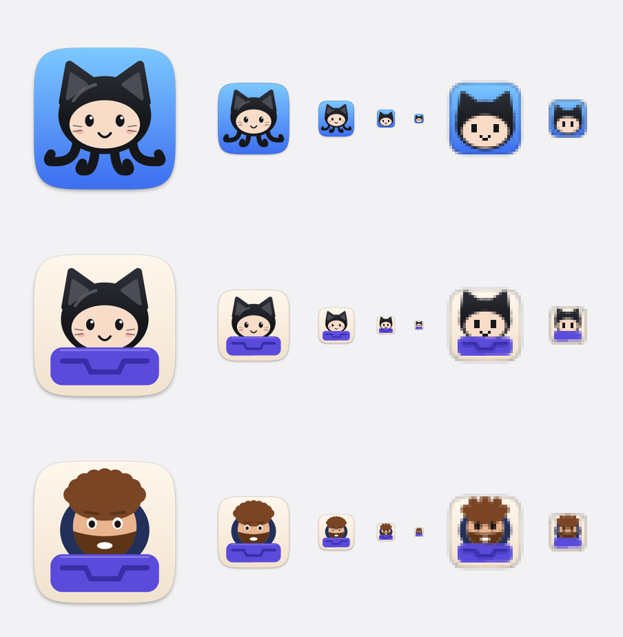

# GitHub Pet app icon — initial directions (#88)

Design record for [issue #88](https://github.com/christopherrbrown3/github-pet/issues/88).

**Status: Chris approved Direction A (Mona portrait) on 2026-11-20 (recorded on #88).** The production iconset is [`assets/app-icon/AppIcon.iconset/`](../../../assets/app-icon/AppIcon.iconset). Directions B and C are kept as explorations only. Do not ship them.

| Light | Dark |
| --- | --- |
|  |  |

Each contact-sheet row shows: the 1024 master at 256, then 128, 64, 32 and 16 px at 1×, then 32 and 16 px magnified ×4 with nearest-neighbour sampling so pixel legibility is visible.

## Directions

- **A · Mona portrait. Approved default identity.** Mona's cat hood, peach face and tentacle skirt on a sky-to-cobalt gradient tile. Strongest at 16/32 px: the black head and peach face read on blue in light and dark contexts. Below 64 px the tentacles drop out and the head is enlarged.
- **B · Mona inbox peek (exploration, not adopted).** Mona rises from an indigo inbox tray on a warm cream tile, which says "notifications" more directly. At 16 px the tray and face are smaller, so it is less legible than A.
- **C · Little Chris inbox peek (exploration, not adopted).** The same tray composition with Little Chris (hair, beard, navy hood). It shows how a skin-based variant could look. It is not proposed as the default identity.

All three use the macOS icon grid (824 px continuous-corner tile in a 1024 canvas, soft drop shadow, a faint hairline rim so light tiles hold their edge on light backgrounds). No text, no badge, no GitHub Invertocat silhouette or GitHub wordmark. Mona appears as a colored character face rather than a solid silhouette.

## Provenance

- Source: [`render_icons.swift`](render_icons.swift). Every shape is authored vector geometry in a 1024 design space, drawn with CoreGraphics. There are no raster inputs and no image-generation tools. Shapes were drawn by hand in code with reference to the `assets/mascots/mona-pet-v1` and `assets/mascots/little-chris-v1` frames for character traits only.
- Small sizes use a separate level of detail, chosen by pixel size. At 32 px and below, the whiskers, blush, highlights and tentacles drop out and the face is enlarged. The eyes and mouth are snapped to whole device pixels and mirrored about the centre: 2×3 px eyes and a 2 px mouth with upturned corners at 32 px, and 1×2 px eyes with no mouth at 16 px. This keeps them solid black instead of grey anti-aliasing. 64 px and up use the full drawing.
- Rebuild from the repo root: `swift docs/design/app-icon-88/render_icons.swift`. Outputs are `renders/<direction>/icon-{16,32,64,128,256,512,1024}.png`, `renders/contact-{light,dark}.png` and the production `assets/app-icon/AppIcon.iconset/`. Re-running produces byte-identical PNGs (SHA-256 compared on the iconset).

## Production handoff

[`assets/app-icon/AppIcon.iconset/`](../../../assets/app-icon/AppIcon.iconset) contains the ten standard macOS images: `icon_{16,32,128,256,512}x{…}.png` at @1x and @2x, from 16 to 1024 px. They are RGBA sRGB PNGs totalling about 576 KB, rendered from Direction A. Each image is drawn at its own pixel size, not downsampled from the master. `icon_16x16@2x.png` is the 32 px drawing and `icon_32x32@2x.png` is the 64 px drawing.

Validation on this Mac: `iconutil -c icns assets/app-icon/AppIcon.iconset -o <tmp>/AppIcon.icns` exits 0 and produces a 565,056-byte `Mac OS X icon` file. `iconutil -c iconset` round-trips it back to 10 images.

The developer owns packaging. That means generating `AppIcon.icns` with `iconutil` at build time, staging it in `Contents/Resources`, setting `CFBundleIconFile` and signing after the resource is installed. `LSUIElement` stays unchanged. The `.icns` is intentionally not committed.
