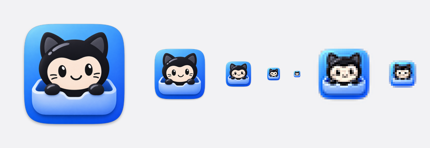
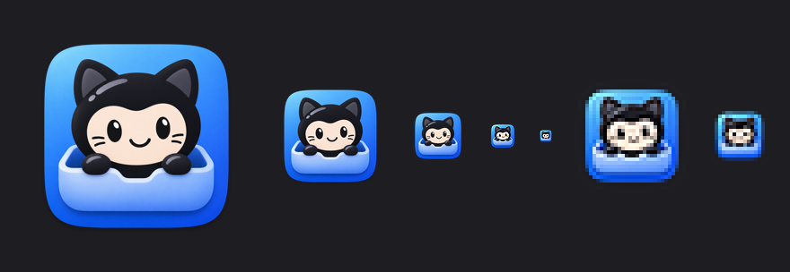

# GitHub Pet app icon (#88)

Design record for [issue #88](https://github.com/christopherrbrown3/github-pet/issues/88).

**Status: shipping icon is the painted Mona inbox peek (Direction B, painted), chosen by Chris.** It replaces the vector Direction A icon approved on 2026-11-20. The production iconset is [`assets/app-icon/AppIcon.iconset/`](../../../assets/app-icon/AppIcon.iconset), built from the clean master [`painted/painted-b-inbox-clean-1024.png`](painted/painted-b-inbox-clean-1024.png). The vector directions A to C below are kept as history; the other painted candidates (`painted-a-portrait.png`, `painted-c-envelope.png`) are not shipped.

| Light | Dark |
| --- | --- |
|  |  |

Each row shows the 1024 master at 256, then 128, 64, 32 and 16 px at 1×, then 32 and 16 px magnified with nearest-neighbour sampling.

## Painted icon: clean master and iconset

The generated tile had a hazy, uneven blue edge and a soft halo, and it is about 843 × 854 px rather than the 824 px macOS tile. [`build_painted_icon.swift`](build_painted_icon.swift) fixes this with resampling and compositing only. It never repaints the character.

1. The painted tile's measured bounds are scaled uniformly (about 0.977) onto the 824 px tile of `render_icons.swift` in the 1024 canvas.
2. The painted edge band (haze, rim light, halo, baked shadow) is discarded. Inside a core inset 16 px from the painted edge the generated pixels are kept. Outside it each pixel takes the tile's own colour sampled just inside the core along the radius, so the gradient extends under the clip. A 4 px cross-fade hides the seam.
3. The result is clipped to the exact continuous-corner tile path, with the drop shadow and hairline rim drawn in code as `render_icons.swift` does. The master's alpha differs from the vector Direction B render by at most 3/255, from the rim opacity (blue-tile 10 % instead of the cream tile's 9 %).
4. Each iconset image is a Lanczos-3 downsample of the 1024 master, in premultiplied RGBA. Nothing is hand-drawn at small sizes, so there is one identity at every size. `icon_16x16@2x.png` and `icon_32x32.png` are the same 32 px image, and `icon_32x32@2x.png` is 64 px.

**Small sizes (16 and 32 px).** [`renders-painted/small-size-compare.png`](renders-painted/small-size-compare.png) compares plain Lanczos with an unsharp mask (σ 0.7 px, amount 0.6, colour channels only, alpha untouched) at 32 px (top two rows) and 16 px (bottom two rows), on light and dark, at 1× and magnified. The sharpened variant was chosen. The plain downsample turns the eyes and face outline to grey mush at 1×, while the sharpened one keeps two distinct eyes, the face and the tray lip. The cost is slight edge ringing, visible only magnified. 64 px and up are not sharpened. The choice is the `sharpenSmall` constant in the script.

Rebuild from the repo root (about two minutes, interpreted Swift): `swift docs/design/app-icon-88/build_painted_icon.swift`. It writes the clean master, the ten-image iconset and `renders-painted/`. Two consecutive runs produced byte-identical files (SHA-256 compared).

Provenance of the painted source, its generation artifact ID and prompt intent are in [`../provenance.md`](../provenance.md).

## Packaging

`iconutil -c icns assets/app-icon/AppIcon.iconset` is run by `scripts/build-app.sh` at build time. `scripts/verify-app-icon.sh` and `scripts/test-packaging.sh` check the result. The `.icns` is intentionally not committed.

## Earlier vector directions (history)

`render_icons.swift` still renders the three vector directions into `renders/`. It writes a vector iconset only if given an explicit iconset directory, and no longer touches `assets/app-icon/`.

## Directions

- **A · Mona portrait. Approved 2026-11-20, now superseded by the painted Direction B (see above).** Mona's cat hood, peach face and tentacle skirt on a sky-to-cobalt gradient tile. Strongest at 16/32 px: the black head and peach face read on blue in light and dark contexts. Below 64 px the tentacles drop out and the head is enlarged.
- **B · Mona inbox peek (exploration, not adopted).** Mona rises from an indigo inbox tray on a warm cream tile, which says "notifications" more directly. At 16 px the tray and face are smaller, so it is less legible than A.
- **C · Little Chris inbox peek (exploration, not adopted).** The same tray composition with Little Chris (hair, beard, navy hood). It shows how a skin-based variant could look. It is not proposed as the default identity.

All three use the macOS icon grid (824 px continuous-corner tile in a 1024 canvas, soft drop shadow, a faint hairline rim so light tiles hold their edge on light backgrounds). No text, no badge, no GitHub Invertocat silhouette or GitHub wordmark. Mona appears as a colored character face rather than a solid silhouette.

## Vector directions provenance

- Source: [`render_icons.swift`](render_icons.swift). Every shape is authored vector geometry in a 1024 design space, drawn with CoreGraphics. For these vector directions A to C there are no raster inputs and no image-generation tools; the painted icon above is a separate, image-generated source. Shapes were drawn by hand in code with reference to the `assets/mascots/mona-pet-v1` and `assets/mascots/little-chris-v1` frames for character traits only.
- Small sizes use a separate level of detail, chosen by pixel size. At 32 px and below, the whiskers, blush, highlights and tentacles drop out and the face is enlarged. The eyes and mouth are snapped to whole device pixels and mirrored about the centre: 2×3 px eyes and a 2 px mouth with upturned corners at 32 px, and 1×2 px eyes with no mouth at 16 px. This keeps them solid black instead of grey anti-aliasing. 64 px and up use the full drawing.
- Rebuild from the repo root: `swift docs/design/app-icon-88/render_icons.swift`. Outputs are `renders/<direction>/icon-{16,32,64,128,256,512,1024}.png` and `renders/contact-{light,dark}.png`. Re-running produces byte-identical PNGs (SHA-256 compared on the iconset).
