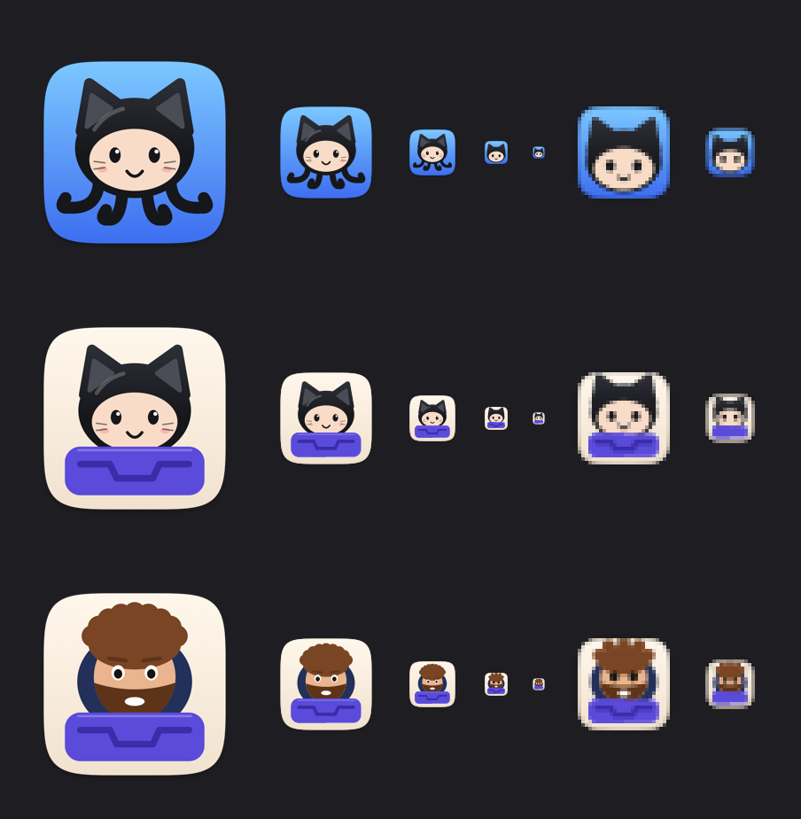

# GitHub Pet app icon — initial directions (#88)

These are review directions for [issue #88](https://github.com/christopherrbrown3/github-pet/issues/88). Chris picks one; production assets follow after approval.

| Light | Dark |
| --- | --- |
|  |  |

Each contact-sheet row shows: the 1024 master at 256, then 128, 64, 32 and 16 px at 1×, then 32 and 16 px magnified ×4 with nearest-neighbour sampling so pixel legibility is visible.

## Directions

- **A · Mona portrait (recommended default).** Mona's cat hood, peach face and tentacle skirt on a sky-to-cobalt gradient tile. Strongest at 16/32 px: the black head and peach face read on blue in light and dark contexts. Below 64 px the tentacles drop out and the head is enlarged.
- **B · Mona inbox peek.** Mona rises from an indigo inbox tray on a warm cream tile, which says "notifications" more directly. At 16 px the tray and face are smaller, so it is less legible than A.
- **C · Little Chris inbox peek (exploration only).** The same tray composition with Little Chris (hair, beard, navy hood). It shows how a skin-based variant could look. It is not proposed as the default identity.

All three use the macOS icon grid (824 px continuous-corner tile in a 1024 canvas, soft drop shadow, a faint hairline rim so light tiles hold their edge on light backgrounds). No text, no badge, no GitHub Invertocat silhouette or GitHub wordmark. Mona appears as a colored character face rather than a solid silhouette.

## Provenance

- Source: [`render_icons.swift`](render_icons.swift). Every shape is authored vector geometry in a 1024 design space, drawn with CoreGraphics. There are no raster inputs and no image-generation tools. Shapes were drawn by hand in code with reference to the `assets/mascots/mona-pet-v1` and `assets/mascots/little-chris-v1` frames for character traits only.
- Small sizes use a separate level of detail: 32 px drops whiskers, blush, highlights and tentacles and enlarges the eyes and face. 16 px also drops the smile and the tray notch.
- Rebuild from the repo root: `swift docs/design/app-icon-88/render_icons.swift`. Output is `renders/<direction>/icon-{16,32,64,128,256,512,1024}.png` plus `renders/contact-{light,dark}.png`. The renderer is deterministic.

## Handoff (after approval)

The developer packages the approved direction's renders as an `.iconset` (16, 32, 128, 256, 512 at @1x and @2x), builds `AppIcon.icns` with `iconutil`, stages it in `Contents/Resources` and sets `CFBundleIconFile`. `LSUIElement` is unchanged. The designer will provide the final iconset after Chris approves a direction.
